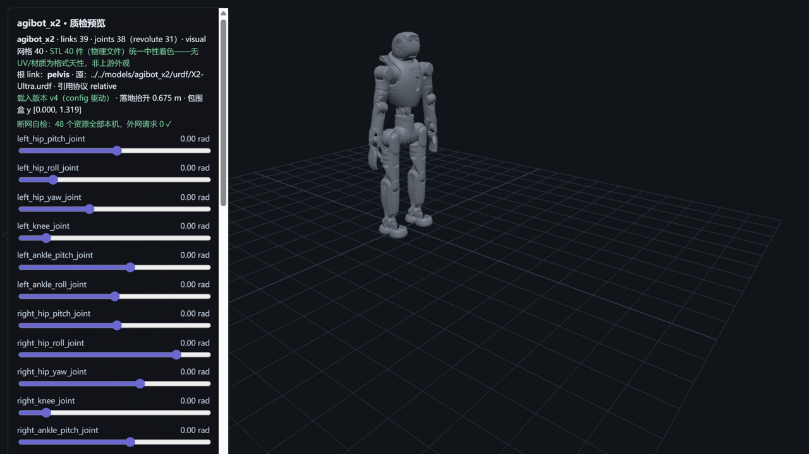

# agibot_x2 — 智元灵犀 X2（M3 · 国产开源许可证首例）



> **管道预览页**渲染截图（`?model=agibot_x2`）——模型文件即本页所述入库件，零外网依赖；
> 第三家厂商收录、**首个非 BSD/MIT/Apache 系许可证（木兰宽松许可证第 2 版）**、
> 引用协议第四形态确认（`./meshes/` 显式前缀，与 Lite3 同款）+ MJCF `meshdir` 裸文件名首例。
> 包围盒 1.319 m ↔ 官网"身高约 1.31 m"逐位吻合（含 12 cm 躯干徽标件）。

## Provenance（来源与授权）

| 项 | 值 |
|---|---|
| 单仓双源 | AgibotTech/agibot_x2_urdf @ `575cc6b988f976c23550e0db85aa1e5475d3652d`（`X2_URDF-v1.4.0/`——双版本目录仓，v1.3.0 旧版整套不入库） |
| License | **MulanPSL-2.0**（木兰宽松许可证，第 2 版）——GitHub 端点 NOASSERTION 为检测器盲区，本库按原文定性（**R17 人工定性三件套先例：blob 正本 `adf05533` + SPDX 官方名录 `isOsiApproved=true` + 义务清单**）。版权方 = 智元机器人（AgibotTech）；**上游 LICENSE 为许可模板、未含逐字版权主体行（R17 检查点：如实注记，不虚构）**，官方声明见 evidence（README_CN："本项目采用木兰宽松许可证，第2版（Mulan PSL v2）开源"）。原文快照随文件入库：`LICENSE-upstream-agibot_x2_urdf.txt`（6752 B）——分发附副本即 §4 义务履行 |
| 官方性验证 | 路径②成立（org 官方字段自指 agibot.com + 23 仓生态互证 + README 官方声明 + 官网页脚生态仓直链）；路径①阴性如实记录（四站探测无 AgibotTech 直链）——强度与 M1 相当，详见 [SOURCE.md](SOURCE.md) |
| 入库对账 | **83 溯源件 / 158.0 MB，三锚全过**（models↔manifest↔上游 blob id）+ 1 质检截图（S5 自产，不入三锚）；唯一源 43（40 网格双侧各落位一份保持官方引用结构）+ excluded 35 逐件带 why——[S4-package.md](reports/S4-package.md) |
| 配对 | `X2-Ultra.urdf`（39 link / 38 joint）↔ `X2-Ultra.xml`（旗舰焕新版：官方 README"upgraded motors, reinforced structure"）；EDU/手部变体/简化碰撞/scene.xml 不入库只记录 |
| 引用协议 | URDF **relative（`./meshes/` 显式前缀，72 引 → 40 物理件，大小写失配 0）**；MJCF **`meshdir="meshes/"` + 裸文件名**（unitree/Lite3 之外的第四种组合首例，build_plan closure 以 src_rel 指 meshes/、dest 配 mjcf/meshes 零改码兼容） |

## 使用

**MuJoCo 查看**

```bash
python -m mujoco.viewer --mjcf=models/agibot_x2/mjcf/X2-Ultra.xml
```

**Python 加载**

```python
import mujoco
model = mujoco.MjModel.from_xml_path("models/agibot_x2/mjcf/X2-Ultra.xml")
data = mujoco.MjData(model)
mujoco.mj_step(model, data)
```

**在线预览**：仓库根目录跑 `python -m http.server 8130`，打开
`http://127.0.0.1:8130/pipeline/s5_preview/index.html?model=agibot_x2`——31 个关节滑条可交互
（含头部俯仰/偏航双关节）；STL 40 件（物理文件，72 处引用复用）统一中性着色；断网可用。

## 质检结论

| 项 | 结果 |
|---|---|
| 格式校验（S2） | **10 PASS / 0 FAIL**：URDF 39 link/38 joint（根=pelvis）、72 处引用 100% 解析 + 大小写核验失配 0、40 网格 trimesh 全读通；MJCF 编译 nbody=33/njnt=32/nq=38/**nu=31**（31 revolute ↔ 31 hinge ↔ 31 执行器逐数自洽） |
| 物理体检（S3） | **8 PASS / 4 WARN / 0 FAIL**（WARN 见披露）；两侧质量逐 body **32/32 完全一致**（44.801 kg 同值）、31 对关节轴逐分量差 0；effort 基准=官网关节峰值扭矩 120 N·m |
| 基准（S6） | MuJoCo 步进 **39,086 steps/s**（25.6 µs/step）、加载 454.5 ms、展幅 4.5%——四模型序列第四点（Go2 105k / G1 51k / Lite3 48k），33 body/99 geom 复杂度主导，**跨模型数字不可比**再实证 |
| 报告 | [reports/](reports/)——S1-fetch / S2-validation / S3-physics / S4-package / S6-benchmark |

## ⚠️ 已知分歧披露（质检的一部分，E1）

**本模型未做任何参数修改（零修复纯体检）**。以下如实披露：

### 1 · `agibot.stl` 徽标件与 scale 陷阱（上游两格式一致；本库预览器曾踩坑已修）

- torso_link 的第 2 个 visual 网格 `./meshes/agibot.stl`（品牌飘带 logo，"agibot" 字母造型）是
  **native 尺寸 3.959 × 0.809 × 0.389 m 的大件**，上游在**两种格式里都**用缩放把它收为 ~12 cm 躯干徽标：
  URDF `scale="0.03 0.05 0.11"` + `rgba="0 0 0 0.5"` 半透明黑（X2-Ultra.urdf L478），MJCF 同 scale 同半透明——
  **两格式对徽标件完全一致，上游无分歧**（R18 审核台 L478 逐字实证）。
- **本库预览器曾踩坑（已修，AGENT-LAB L12）**：preview.js 早期版本不读 `<mesh scale>` 属性，
  徽标按 native 3.96 m 渲染成横贯场景的幽灵飘带，把包围盒撑到 1.519 m / 3.959 m——
  **忽略 scale 的查看器会得到同样的幽灵几何**。修复后（scale 属性已应用）含徽标包围盒
  **1.319 m ↔ 官网"身高约 1.31 m"逐位吻合**（宽 0.309 m / 深 0.681 m）。
- **下游影响提示**：自行解析此 URDF 的同学务必读 `<mesh scale>` 属性——trimesh/自写加载器
  按 native 尺寸渲染即得 4 m 幽灵；对包围盒、碰撞可视化、RL 观测渲染都是失真源。
  native STL 尺寸与最终视觉尺寸差 30 倍以上，是 scale 属性最该被检查的信号。

### 2 · 总质量 44.801 kg vs 官网"约 39 kg"（+14.9%，超 ±10% 容差——WARN）

- URDF 与 MJCF 两侧**同值 44.801 kg（逐 body 32/32 一致）**——分歧不在格式间，在模型 vs 官网标称。
- 口径注记：官网参数表未注明含电池（电池约 500Wh 支持换电、包装清单中电池单独列示）；
  v1.4.0 为"电机升级/结构加强"焕新版，实测重量可能高于页面标称。严格口径不可比，仅作 sanity（M0/M1/M2 同法），不修。

### 3 · 自由度口径：URDF 31 revolute vs 官网"主动自由度 30"

- 官网旗舰版 30 = 颈 1 + 双臂 7×2 + 腰 3 + 双腿 6×2；URDF 头部有 **pitch+yaw 两个关节**（官网表"颈部自由度 1"）
  → 31 = 30 + head_pitch。MJCF nu=31 含头部双关节全执行。披露不修，引用动作空间时注意口径。

### 4 · 传感器座无惯量/无碰撞（普遍约定，WARN）

- 7 个 fixed 传感器/转子座（imu×2 / lidar_chest / rgbd_head / stereo_head / rgb×2）无 `<inertial>`、无 `<collision>`
  （32/39 link 有碰撞体）——fixed link 合并是各引擎普遍约定，活动关节零质量才 FAIL（规则精化）。标记不自动补。

### 5 · R17 口径小瑕备案

- S0 不入库清单曾单列 `x2_fist*`——该件仅存在于 v1.3.0（整目录已被 sparse 隔离），单列冗余（无害），按 R17 备案理解。

## 口径与来源注记

- 官网参数表（2026-10-11 抓取，`evidence/official-x2-spec-page.html` 原件）：X2 青春版 35 kg / 旗舰版 39 kg、
  身高约 1.31 m、主动自由度 25/30、关节峰值扭矩 120 N·m、电池约 500 Wh（换电）、负载 3 kg。
  本库锚定**旗舰版**口径（X2-Ultra v1.4.0）。
- 官网未公布逐关节限位/关节级扭矩——S3 限位对账无官网基准，纯体检+披露（Lite3 同口径）。
- 上游漂移监控：pin `575cc6b9`（2026-09-21），S1 时对账无漂移。
