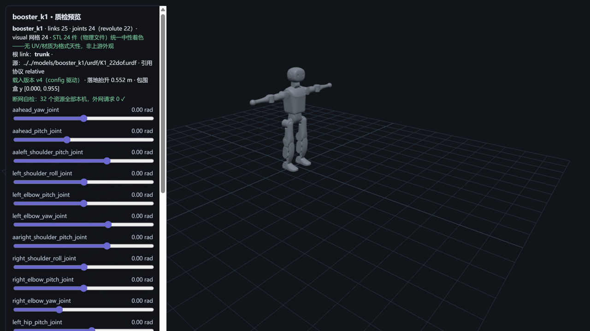

# booster_k1 — 加速进化 K1（M7 · 同仓第二机型线 · 本库最小型 0.95 m）



> **管道预览页**渲染截图（`?model=booster_k1`）——模型文件即本页所述入库件，零外网依赖；
> 同仓第二机型线（T1 之后）、**本库最小型机型**（0.95 m / 19.5 kg 档，与 DR02 1.79 m 构成尺度带两极）；
> **首个官网产品页直证机型**（A4 路径①转正，见披露 1）；
> **包围盒 y [0.000, 0.955] ↔ 官网"身高约 95 厘米"逐位命中**（+5 mm 零位/标称姿态差——身高官方对账第二例）。

## Provenance（来源与授权）

| 项 | 值 |
|---|---|
| 单仓双源 | BoosterRobotics/booster_assets @ `12a97516f57469078707afb587a5f84c1cb110d1`（`robots/K1/`——与 M4 T1 同 HEAD 零漂移，上游无新 push） |
| License | **BSD-3-Clause**（整仓单 license，与 M4 T1 快照**逐字节同物** `d7a14af35ecb…`，R31 双重同物全验无新定性）。原文快照随文件入库：`LICENSE-upstream-booster_assets.txt`；版权行 `Copyright (c) 2025, BoosterRobotics`（快照逐字，N1） |
| 官方性验证 | **双路径全中（路径①转正）**：官网首页 meta 明列 "Booster K1、T2 人形机器人" + K1 产品页 `/cn/booster-k1` 完整实存（336,389 B 二进制原件落 evidence，R29 取证范式——本次零 token 无需脱敏）；**官网域名已迁移 boosterobotics.com → booster.tech（301）**，取证路径经新域；路径②四件互证继承 M4（账户 blog/README 配置表/gym 官方署名/版权行主体）。详见 [SOURCE.md](SOURCE.md) |
| 入库对账 | **50 物理件 / 24.0 MB，三锚全过**（models↔manifest↔上游 blob id）+ 1 质检截图（S5 自产，不入三锚）；单池网格 24 件双侧落位（两侧同哈希）；excluded 2（locomotion 裁剪变体 + parallel 并联踝）——[S4-package.md](reports/S4-package.md) |
| 配对 | `K1_22dof.urdf`（25 link / 22R + 2F）↔ `K1_22dof.xml`（26 body/23 joint）——**官方双文档 DoF 三方逐位**：官网"全身 22=头部 2+双臂 8+双腿 12" ↔ assets README 配置表 ↔ URDF 22R；K1_locomotion（裁剪变体）/K1_22dof_parallel（并联踝）不入库只记录 |
| 引用协议 | URDF **relative（`meshes/` 前缀，32 引 → 24 物理件，大小写失配 0，scale 双侧 0）**；MJCF **meshdir 相对引用**（单池 52 件共享，closure 零改动落位） |

## 使用

**MuJoCo 查看**

```bash
python -m mujoco.viewer --mjcf=models/booster_k1/mjcf/K1_22dof.xml
```

**Python 加载**

```python
import mujoco
model = mujoco.MjModel.from_xml_path("models/booster_k1/mjcf/K1_22dof.xml")
data = mujoco.MjData(model)
mujoco.mj_step(model, data)
```

**在线预览**：仓库根目录跑 `python -m http.server 8130`，打开
`http://127.0.0.1:8130/pipeline/s5_preview/index.html?model=booster_k1`——22 关节滑条可交互；
STL 24 件（物理文件）统一中性着色；断网可用（32 资源全本机外网 0）。

## 质检结论

| 项 | 结果 |
|---|---|
| 格式校验（S2） | **10 PASS / 0 FAIL**：URDF 25 link/24 joint（根=trunk）、32 处引用 100% 解析 + 大小写失配 0、24 网格 trimesh 全读通；MJCF 编译 nbody=26/njnt=23/nq=29/**nu=22**（22 单自由度活动关节 ↔ 22 hinge，nq=22+free7 自洽） |
| 物理体检（S3） | **10 PASS / 3 WARN / 0 FAIL / 0 SKIP**（连续第二个最净档）；两侧总量 **19.666 kg vs 官网 19.5 kg（+0.9%）且 URDF/MJCF 同值**；逐 body **23/23 完全一致** + **COM 23/23 差 0.00e+00**；22 对关节轴逐分量差 0；**官方 DoF 基准三方逐位**（本库第二个 DoF 基准齐备机型） |
| 基准（S6） | MuJoCo 步进 **40,549 steps/s**（24.7 µs/step）、加载 64.8 ms、展幅 19.2%——八模型序列第六点（DR02 110k / Go2 105k / G1 51k / Lite3 48k / M20 43.9k / **K1 40.5k** / X2 39k / T1 36.8k），26 body/45 geom，**跨模型数字不可比**再实证 |
| 报告 | [reports/](reports/)——S1-fetch / S2-validation / S3-physics / S4-package / S6-benchmark |

## ⚠️ 已知分歧披露（质检的一部分，E1）

**本模型未做任何参数修改（零修复纯体检）**。以下如实披露：

### 1 · 官网域名迁移与 A4 路径①转正（本模型核心侦察成果）

- **M4 侦察结论"官网无 K1 页、现主打 T2"被当前官网推翻**：官网首页 meta 明列 "Booster K1、T2 人形机器人"、
  K1 产品页 `/cn/booster-k1` 完整实存（规格表+应用场景+Product JSON-LD）；
- **原因实证**：官网域名已迁移 `boosterobotics.com` → `booster.tech`（301 重定向，审核台活源实测）——
  M4 快照系旧域时代采样。**教训入库："快照会过期、活源才有效"**（M4 阴性与本次转正都是真的，时间戳不同）；
- M4 历史口径更正为第三例（R17"46"/M4"10 URDF 无 MJCF"/本次），主动修正纪律一以贯之。

### 2 · URDF 注释内的 world 挂载块（grep 字面口径虚增结构元素）

- 上游 URDF 中 `world` link + `world_joint`（floating）**整块处于 XML 注释内**（上游注释掉的挂载方式）——
  与 T1 的**活元素** world+floating 不同；字符串法（grep）会数出 26 link/25 joint（含 1 floating），
  **解析器权威口径 25 link/24 joint（22R+2F，无 floating 无 world）**——yourdfpy/MuJoCo 加载行为与之一致；
- **下游提示**：与 DR02 披露 1 同族（注释内元素虚增计数），且本例直接影响结构断言（floating 有无）——
  引用/结构统计必须过 XML 解析器。

### 3 · 单池网格 52 件收 24（28 件未收，身份自洽）

- `robots/K1/meshes/` 单池 52 件中两侧模型文件引用 24 件（闭包零缺失），28 件未收：
  踝并联机构配套（XX_Ball ×18 + Crank/Link ×8——`K1_22dof_parallel.xml` 变体专用）、
  足端碰撞/旧版件（Foot_Collision/Foot_old）、头部碰撞/相机件（Head_2_Collision/ZED）——
  与 T1 的 38 件未收结构同族（并联件池）。

### 4 · 传感器座无惯量/无碰撞（普遍约定，WARN）

- 2 个 fixed 相机座（head_realsense_rgb/stereo_rgb）无 `<inertial>`；collision 17/25 link
  （**mesh 碰撞 8 处**——本库第二例 mesh 碰撞，DR02 之后；box 3/cylinder 9/mesh 8）；
  MJCF 同位 2 空 body——标记不自动补。

### 5 · 身高官方对账（人形第二例）与 S6 展幅处置记档

- 包围盒 y [0.000, **0.955**] ↔ 官网"身高约 95 厘米"逐位命中（+5 mm 姿态差）；测量法=既定 AABB 并集口径；
- S6 首轮展幅 22.4% 超 20% 验收线（本库首次）——三轮复跑定案：中位三轮一致（39,544/39,132/40,549，
  ±1.8%），同机负载源（浏览器 three.js 标签渲染循环）释放后第三轮 19.2% 过线，
  **取干净环境第三轮 40,549 steps/s 为正式数字**，前两轮超线与负载源假设如实记档。

## 口径与来源注记

- 官网 K1 参数表（`evidence/official-k1-spec-page.html` 原件，336,389 B，新域字节）：
  身高约 95 cm、重量约 19.5 kg、全身 22 DoF（头 2/单臂 4/单腿 6）、教育/展演/机器人足球定位。
- 上游漂移监控：pin `12a97516`（与 M4 同 HEAD，S1 对账零漂移）；上游无新 push，漂移风险低。
- 同仓 T2 线（31DoF 四手部变体矩阵）为 M8+ 跨变体专项候选；DR02 Standard/fix_joints、
  X30、M20_Piper 等维持档案（`workspace/m5_recon/`、`workspace/m6_recon/` 侦察件不入库）。
