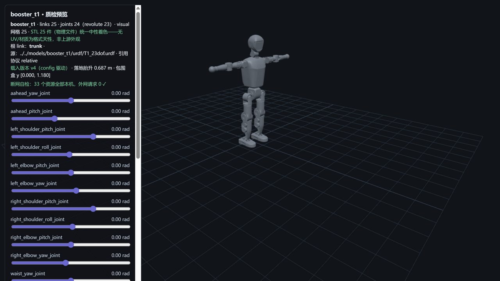

# booster_t1 — 加速进化 T1（M4 · 第四厂商）



> **管道预览页**渲染截图（`?model=booster_t1`）——模型文件即本页所述入库件，零外网依赖；
> 第四家厂商收录、**首个"专用资产仓正本 + 训练仓旁证"生态位**（M3 时代"跨仓配对"预设经侦察修正，
> 见 [SOURCE.md §4](SOURCE.md)）；
> 引用协议第五形态确认（`meshes/` 前缀相对路径，与 G1 无前缀同族）。
> 包围盒高 1.180 m（零位姿态，双臂平展；官方未公布身高基准，如实记录非判据）。

## Provenance（来源与授权）

| 项 | 值 |
|---|---|
| 单仓双源 | BoosterRobotics/booster_assets @ `12a97516f57469078707afb587a5f84c1cb110d1`（`robots/T1/`——专用机器人描述资产仓，活跃维护 pushed 2026-09-26） |
| License | **BSD-3-Clause**（全文在仓 1,502 B）——版权行 **`Copyright (c) 2025, BoosterRobotics`**（快照逐字，N1）。原文快照随文件入库：`LICENSE-upstream-booster_assets.txt`；同账户 gym 仓（Apache-2.0 短格式，GitHub NOASSERTION=方括号版权行盲区）经源修正降为生态旁证、不作本仓门槛（R22 活源全验） |
| 官方性验证 | 路径②成立（账户 blog 字段自指官网 boosterobotics.com + assets README 官方自述与逐机型 DoF 配置表 + gym README 官方署名与三官方仓互链 + 版权行公司主体）；**路径①阴性如实记录**（官网首页 227,886 B + T2 产品页 263,184 B 双页零 GitHub 直链零 T1——JS 渲染站，官网现主打 T2）——强度与 M1/M3 分层口径相当，详见 [SOURCE.md](SOURCE.md) |
| 入库对账 | **52 物理件 / 17.4 MB，三锚全过**（models↔manifest↔上游 blob id）+ 1 质检截图（S5 自产，不入三锚）；唯一源 27（25 网格双侧各落位一份保持官方引用结构 + 2 模型文件）+ excluded 4 逐件带 why——[S4-package.md](reports/S4-package.md) |
| 配对 | `T1_23dof.urdf`（25 link / 24 joint）↔ `T1_23dof.xml`——**官方 README 配置表背书**（T1 行逐字"head 2 joints, arms 4 joints ×2, waist 1 joint, legs 6 joints ×2"，算术自洽 2+8+1+12=23）；T1_29dof（无 xml 配对）/T1_locomotion（裁剪变体）/T1_23dof_parallel（并联变体，R22 已裁）不入库只记录 |
| 引用协议 | URDF **relative（`meshes/` 前缀，25 引 → 25 物理件，大小写失配 0）**；MJCF **`meshdir="meshes/"` + 裸文件名**（X2 同构，closure 零改码兼容） |

## 使用

**MuJoCo 查看**

```bash
python -m mujoco.viewer --mjcf=models/booster_t1/mjcf/T1_23dof.xml
```

**Python 加载**

```python
import mujoco
model = mujoco.MjModel.from_xml_path("models/booster_t1/mjcf/T1_23dof.xml")
data = mujoco.MjData(model)
mujoco.mj_step(model, data)
```

**在线预览**：仓库根目录跑 `python -m http.server 8130`，打开
`http://127.0.0.1:8130/pipeline/s5_preview/index.html?model=booster_t1`——23 个关节滑条可交互；
STL 25 件（物理文件）统一中性着色；断网可用（33 资源全本机外网 0）。

## 质检结论

| 项 | 结果 |
|---|---|
| 格式校验（S2） | **10 PASS / 0 FAIL**：URDF 25 link/24 joint（根=trunk）、25 处引用 100% 解析 + 大小写失配 0、25 网格 trimesh 全读通；MJCF 编译 nbody=26/njnt=24/nq=30/**nu=23**（23 revolute ↔ 23 hinge ↔ 23 执行器逐数自洽） |
| 物理体检（S3） | **7 PASS / 5 WARN / 0 FAIL / 1 SKIP**（WARN 见披露）；两侧质量逐 body **23/23 完全一致**（31.738/31.740 kg，trunk −0.0016 kg 约定差在容差内）、23 对关节轴逐分量差 0；**官方整机基准缺失**——质量/限位/扭矩纯体检+披露（详见下） |
| 基准（S6） | MuJoCo 步进 **36,766 steps/s**（27.2 µs/step）、加载 51.6 ms、展幅 15.9%——五模型序列第五点（Go2 105k / G1 51k / Lite3 48k / X2 39k），26 body/48 geom 复杂度主导，**跨模型数字不可比**再实证 |
| 报告 | [reports/](reports/)——S1-fetch / S2-validation / S3-physics / S4-package / S6-benchmark |

## ⚠️ 已知分歧披露（质检的一部分，E1）

**本模型未做任何参数修改（零修复纯体检）**。以下如实披露：

### 1 · 官方整机基准缺失（本库首例：无官网基准的机型）

- 官网无 T1 独立产品页（首页与 T2 产品页双页实测零 T1 字样，JS 渲染站，官网现主打 T2）；
  官方渠道穷尽 = gym/assets/deploy 三官方仓 README 均无质量字段（S3 前置实测在案）。
- **处置**：整机质量对比**跳过并 WARN 披露**（管道 mass_kg=null 分支，官方基准缺失不得虚构——
  R17 检查点同源）；URDF/MJCF 实测总量 31.738 / 31.740 kg **仅作记录非判据**。
- **仍然成立的官方对账**：自由度口径——官方 assets README 配置表 T1 行逐字（23 DoF）
  ↔ URDF 23 revolute ↔ MJCF nu=23 三方逐位一致；booster_deploy README "T1 23-DOF configuration" 旁证第三件。
- **下游影响提示**：引用本模型质量做动力学设计时注意这是**上游模型自报值**，无官方整机规格背书。

### 2 · URDF 碰撞体全基元（轻量碰撞模型）

- URDF 20/25 link 有 `<collision>`，全部为基元（box 5 / cylinder 14 / sphere 1），**零 mesh 碰撞**；
  5 link 无 collision（shoulder_roll ×2 / ankle_pitch ×2 / head 相机座）——碰撞几何挂相邻 link，建模约定，标记不自动补。
- **下游影响提示**：碰撞仿真用这套基元即可（轻量高效）；但做精确接触/自碰撞研究时基元近似不足，
  需自行换 visual 网格或专用碰撞网格。

### 3 · 网格池 63 件收 25（38 件未收，身份自洽）

- `robots/T1/meshes/` 63 件 STL 中两侧模型文件共引用 25 件（闭包零缺失），38 件未收：
  踝关节并联机构件（Crank/Link/Ball 系）、手部内部件（left/right_Link* 系）、29dof 变体臂加长件
  （AL4-7/AR4-7——2+14+1+12=29 算术自洽）。均属不入库变体（parallel/手部/29dof）的配套网格。
- 网格池结构独立印证了官方变体叙事：23dof 标准版用串联踝（Ankle_Cross L/R），并联机构另有
  `T1_23dof_parallel.xml`（R22 已裁不入库）。

### 4 · URDF 显式 world link + floating joint（yourdfpy 会规范化掉）

- 上游 URDF 含显式 `world` link + `world_joint`（floating）挂在 trunk 上；yourdfpy 解析时将其规范化
  （root 记为 trunk，24 joints 口径）；MJCF 侧同构——trunk 挂 free joint（nq=30 = 23 hinge + free 7）。
- **下游影响提示**：自行解析此 URDF 时注意 floating joint 的处理（MuJoCo/Isaac 系转换器各不相同），
  S2 口径（25 link/24 joint）与上游 XML 字面（26 link/25 joint 含 world）差异如实记录在案。

### 5 · 包围盒测量法注明（R20 挂账执行项）

- 本库 bbox 测量法 = **three.js Box3 逐 mesh AABB 并集（保守口径）**；页面读数 y [0.000, 1.180]
  （three.js y-up 即身高）、落地抬升 0.687 m。
- 离线互证（yourdfpy trimesh scene.bounds，同法@零位姿态）：三轴 [0.225, 1.215, 1.180]，
  z（身高）1.180 与页 y **逐位同值**、z_min −0.687 与页落地抬升 **逐位同值**——两条证据链同法互证成立。
- 深度口径差的既往背景（X2 送审 0.681 vs 审核 FK 0.643）即源于此测量法差：AABB 并集含网格保守外扩，
  非逐顶点精确投影。后续模型页 bbox 数字一律按本注记口径解读。

## 口径与来源注记

- 官方 README 配置表（`evidence/official-readme-booster_assets.txt` 原件）：T1 23 DoF 标准版 /
  T1 Locomotion（fixed head, arms, waist）/ K1 22 DoF / T2 31 DoF 及四种手部变体——本库锚定 **T1 23dof 标准版**。
- 官网无 T1 产品页——身高/质量/扭矩均无官网基准，S3/S5 相关数字均为模型实测口径（见披露 1/5）。
- 上游漂移监控：pin `12a97516`（2026-09-26 push，S1 对账零漂移）；booster_assets 活跃维护，
  后续对账以本 pin 为准。
