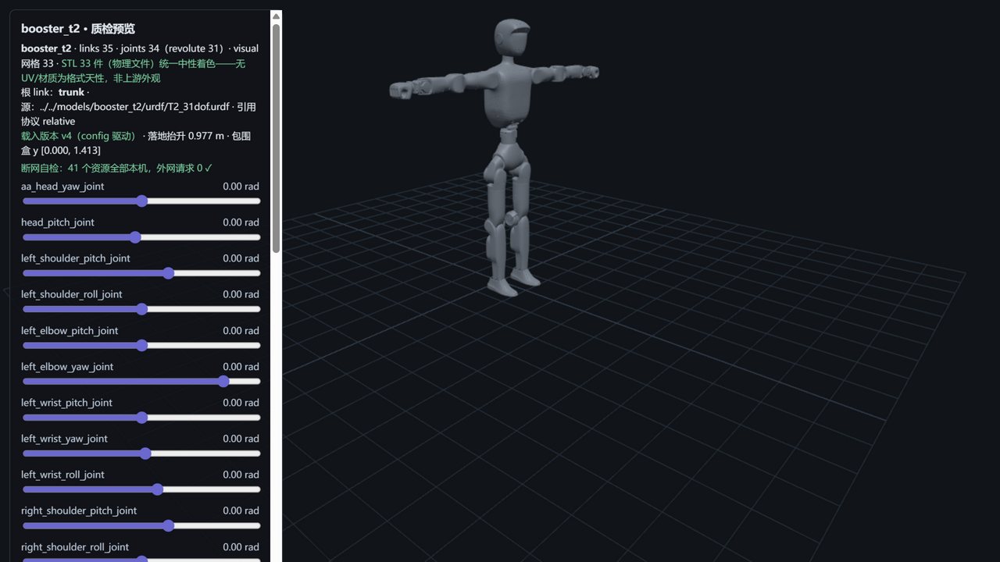

# booster_t2 — 加速进化 T2（M8 · 官网旗舰 · S3 三基准机型）



> **管道预览页**渲染截图（`?model=booster_t2`）——模型文件即本页所述入库件，零外网依赖；
> 同仓第三机型线（T1/K1 之后）、**官网主打旗舰**（140 cm / 42 kg 档，尺度带中位）；
> **S3 三基准机型（本库首个）**：质量+自由度+**峰值扭矩 140 N·m** 三方可参考（effort 为量级 sanity，见披露 3）；
> **包围盒 y [0.000, 1.413] ↔ 官网"身高约 140 厘米"逐位命中**（+13 mm 姿态差——身高官方对账第三例）。

## Provenance（来源与授权）

| 项 | 值 |
|---|---|
| 单仓双源 | BoosterRobotics/booster_assets @ `12a97516f57469078707afb587a5f84c1cb110d1`（`robots/T2/T2_31dof/` 主版子目录——与 M4/M7 同 HEAD 零漂移） |
| License | **BSD-3-Clause**（整仓单 license，与 M4/M7 快照**逐字节同物** `d7a14af35ecb…`，R34 三重同物全验无新定性）。原文快照随文件入库：`LICENSE-upstream-booster_assets.txt`；版权行 `Copyright (c) 2025, BoosterRobotics`（快照逐字，N1） |
| 官方性验证 | **A4 沿用 K1 转正口径**：同域（booster.tech，域名迁移先例在案）同模板三机型页互证；官网 T2 产品页 269,610 B 二进制原件落 evidence（R29 取证范式，本次零 token 无需脱敏）；README 配置表 T2 行双文档交叉。详见 [SOURCE.md](SOURCE.md) |
| 入库对账 | **76 物理件 / 99.1 MB，三锚全过**（models↔manifest↔上游 blob id）+ 1 质检截图（S5 自产，不入三锚）；主版子目录直取（四手部变体整组 subdir 天然隔离）；excluded 1（parallel 并联踝）；**平账全绿（40=39+1，未收为零）历史最净**——[S4-package.md](reports/S4-package.md) |
| 配对 | `T2_31dof.urdf`（**35 link / 31R + 3F，无 floating 无 world**）↔ `T2_31dof.xml`（33 body/32 joint）——**官方双文档 DoF 交叉**：官网"全身 31" ↔ README 配置表（head 2 + arms 7×2 + waist 3 + legs 6×2 = 2+14+3+12=31）↔ URDF 31R 三方逐位；四手部变体（JZgripper/Revo2Hand/WujiHand/YSgripper）整组不入库只记录（X2 手部先例） |
| 引用协议 | URDF **relative（`meshes/` 前缀，39 引 → 37 物理件，大小写失配 0，scale 双侧 0）**；MJCF **meshdir 相对引用**（分目录自有池，closure 零改动落位） |

## 使用

**MuJoCo 查看**

```bash
python -m mujoco.viewer --mjcf=models/booster_t2/mjcf/T2_31dof.xml
```

**Python 加载**

```python
import mujoco
model = mujoco.MjModel.from_xml_path("models/booster_t2/mjcf/T2_31dof.xml")
data = mujoco.MjData(model)
mujoco.mj_step(model, data)
```

**在线预览**：仓库根目录跑 `python -m http.server 8130`，打开
`http://127.0.0.1:8130/pipeline/s5_preview/index.html?model=booster_t2`——31 关节滑条可交互；
STL 33 件（物理文件）统一中性着色；断网可用（41 资源全本机外网 0）。

## 质检结论

| 项 | 结果 |
|---|---|
| 格式校验（S2） | **9 PASS / 1 FAIL / 0 WARN**：URDF 35 link/34 joint（根=trunk；**names-unique FAIL 见披露 1**）、39 处引用 100% 解析 + 大小写失配 0、37 网格 trimesh 全读通；MJCF 编译 nbody=33/njnt=32/nq=38/**nu=31**（31 单自由度活动关节 ↔ 31 hinge，nq=31+free7 自洽）——**FAIL 不阻塞加载**（yourdfpy/MuJoCo 双引擎实测可加载，披露 1） |
| 物理体检（S3） | **10 PASS / 3 WARN / 0 FAIL / 0 SKIP**；两侧总量 **41.994 kg vs 官网 42.0 kg（−0.0%，本库最贴逐位）且 URDF/MJCF 同值**；逐 body **31/31 完全一致 + 2 项约定差异**（logo urdf 独有 0.001 kg/trunk −0.0010，对齐 S3 报告原文）；31 对关节轴逐分量差 0；**三基准 sanity 对账（本库首个三基准机型）**：质量 42 kg + DoF 31 分解 + **effort 量级 sanity**（31R effort 分布 22~144 N·m，max=waist_roll 144 对官网峰值 140 为 +2.9% 量级一致，非逐位对账） |
| 基准（S6） | MuJoCo 步进 **27,583 steps/s**（36.3 µs/step）、加载 229.0 ms、展幅 10.2% 稳过——**九模型序列最慢点**（33 body/55 geom 最复杂模型，复杂度主导叙事闭环） |
| 报告 | [reports/](reports/)——S1-fetch / S2-validation / S3-physics / S4-package / S6-benchmark |

## ⚠️ 已知分歧披露（质检的一部分，E1）

**本模型未做任何参数修改（零修复纯体检）**。以下如实披露：

### 1 · FAIL：link 与 joint 重名 `logo`（本库第二个 FAIL 级发现，names-unique 首触发）

- 上游 URDF 中 trunk 挂载的 0.001 kg 装饰牌，其 **link 名与挂载 joint 名同名同为 `logo`**——
  URDF 规范要求全图元素名唯一，多数解析器按 link/joint 分名字空间处理故容忍，但严格校验器会拒绝；
- 本库 names-unique 检查（link+joint 联合名字空间）首次触发 **FAIL**；**fail 不静默**：yourdfpy 与
  MuJoCo 双引擎实测均可正常加载（分名字空间容忍），**零修复如实披露**；
- **下游影响提示**：用严格 URDF 校验器（如 urdfdom 哈希校验类工具）处理此文件可能报错——
  引用动作空间/构建 TF 树时以 joint 名索引即可避开。

### 2 · floating/world 口径（R34 更正令①执行件——注释内块第二次实证实录）

- 上游 URDF 的 `world` link + `world_joint`（floating）**整块处于 XML 注释内**（与 K1 同仓同模板同款，
  注释块还含 mujoco compiler 提示）——**解析器权威口径 35 link/34 joint（31R+3F，无 floating 无 world）**；
- R34 曾记口径轻度越界（"36 link/1 floating"系 grep 混写）——本页即更正令执行件；
  **下游提示**：引用此模型结构参数时以 35/34 为准（yourdfpy/MuJoCo 加载行为与之一致）。

### 3 · 三基准 sanity 对账（本库首个）与 42 kg 星号注记

- 官网 T2 页提供**三方可参考基准**：整机重量 42 kg + 全身 31 DoF + 最大峰值扭矩 140 N·m——
  本库 S3 首次实现三基准对账；**effort 对账口径（R35 更正）：31R effort 分布 22~144 N·m，
  max=waist_roll 144 > 官网峰值 140（+2.9% 量级一致）——量级 sanity 而非逐位对账**；
- **星号脚注原文**（S3 前置逐字核对）："**\*不同版本不同选配下重量略有差异**"（42 kg）与
  "**\*手臂最大负载，在不同手臂姿态下差异很大，不同姿态下的负载以实际为准**"（10 kg）——
  版本/选配口径而非"不含电池"，对账口径注记如实；
- 两侧总量 41.994 kg 同值（−0.0% 对账本库最贴逐位）。

### 4 · COM 记录级差异（trunk 7.7e-06，R25 裁定②口径）

- 逐 body COM 对账 32 个中 trunk 差 7.70e-06（超记录容差 1e-06，绝对值 0.0000 kg·m 级）——
  记录级 WARN 披露不修；其余 31/31 一致、逐 body 质量 31/31 完全一致（logo 约定差异见披露 1 关联）。

### 5 · 身高官方对账（人形第三例）与变体矩阵处置

- 包围盒 y [0.000, **1.413**] ↔ 官网"身高约 140 厘米"逐位命中（+13 mm 姿态差）；测量法=既定 AABB 并集口径；
- **四手部变体整组不入库**（JZgripper 43R/Revo2Hand 53R/WujiHand 71R/YSgripper 43R——均为主版 31+手部
  复合体，官网"末端执行器"选项对应）；如需手部形态，"加 config 即加模型"接口现成（M8+ 候选）。

## 口径与来源注记

- 官网 T2 参数表（`evidence/official-t2-spec-page.html` 原件，269,610 B，新域字节零 token）：
  身高约 140 cm、重量约 42 kg\*、全身 31 DoF、双臂最大负载 10 kg\*、最大峰值扭矩 140 N·m、
  行走速度 3 m/s、末端执行器 默认/夹爪/灵巧手。
- 上游漂移监控：pin `12a97516`（与 M4/M7 同 HEAD，S1 对账零漂移）。
- 同仓其余机型线与云深处系候选维持档案（`workspace/m5_recon/`~`workspace/m8_recon/` 侦察件不入库）。
