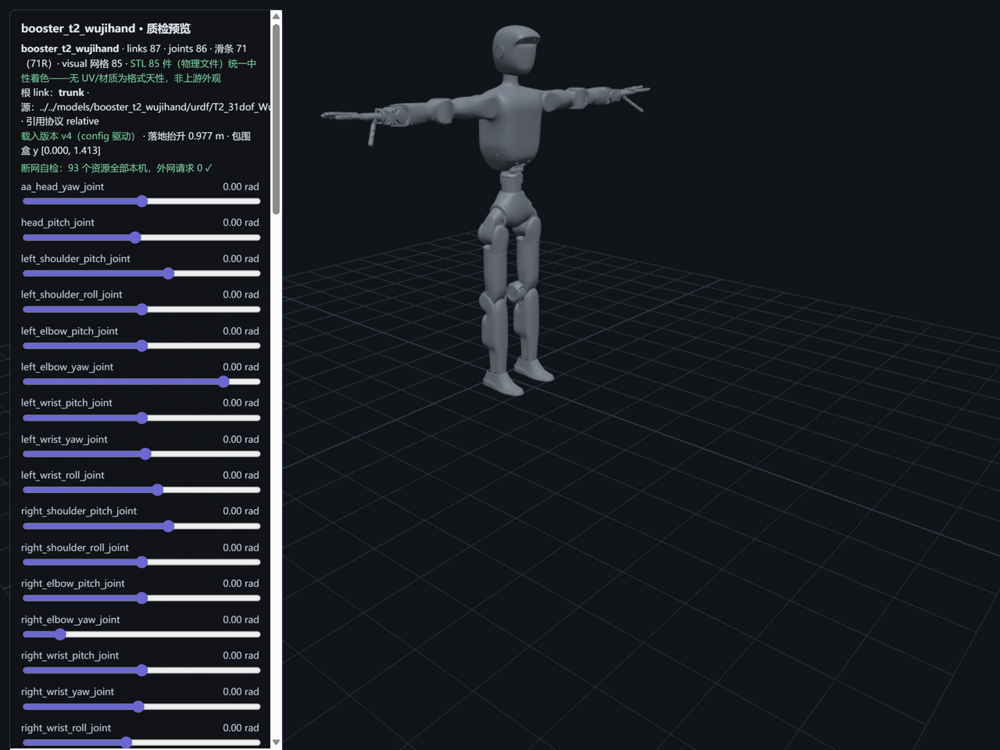

# booster_t2_wujihand — 加速进化 T2 · WujiHand 灵巧手变体（M11 · 变体矩阵首件入库 · 71R 本库最大关节模型）



> **变体谱系（R44 条件①）**：本模型 = T2 主版（`T2_31dof`，31R）的 **WujiHand 灵巧手变体**——T2 五变体矩阵
> （主版 31R + 四手部 JZgripper 43R / Revo2Hand 53R / **WujiHand 71R** / YSgripper 43R）中**首个入库件**
> （M8 期"变体不入库只记录"经 R44 协议②**正门升格**为受控入库：每件协议②+谱系标注+其余留池不批量跟进）；
> 主版页见 [booster_t2](../booster_t2/README.md)（本件基座与其逐位对账，见披露 2）。
> **71R = 31（基座，与主版同构）+ 40（双手 5 指 × 4 关节 × 2）**——本库首个 70R 量级模型
> （现役十一模型 revolute 最大 31）；**包围盒 y [0.000, 1.413] 与主版逐位同值**（最高点为头部，手部差异不入顶点——
> 身高对账随主版：↔ 官网"身高约 140 厘米"）。

## Provenance（来源与授权）

| 项 | 值 |
|---|---|
| 单仓双源 | BoosterRobotics/booster_assets @ `12a97516f57469078707afb587a5f84c1cb110d1`（`robots/T2/T2_31dof_WujiHand/` 变体子目录——与 M4/M7/M8 同 HEAD **五战零漂移**） |
| License | **BSD-3-Clause**（整仓单 license 同仓复指：上游根级 LICENSE blob `d7a14af35ecb…` 与 M4/M7/M8 快照**逐字节同物**，无新定性——R44 裁定②）。原文快照随文件入库：`LICENSE-upstream-booster_assets.txt`（与主版快照 sha256 逐位同物 `056db8cc…`）；版权行 `Copyright (c) 2025, BoosterRobotics`。**变体首件入库口径见 LICENSES.md（R44 条件②）** |
| 官方性验证 | **A4 同仓链条第四件继承**：同 org 同仓同 README；官网 T2 页"末端执行器：默认/夹爪/灵巧手"选项明示=变体矩阵官方背书（M8 活源原件复指，不重复取证）。详见 [SOURCE.md](SOURCE.md) |
| 入库对账 | **176 物理文件 / 104.9 MB，三锚全过**（models↔manifest↔上游 blob id；87 网格 URDF/MJCF 双侧同哈希分目录落位）；唯一源 89=91−2（**池外 2 件身份坐实：left/right_wrist_roll_link_collision.STL**，与 URDF wrist_roll 无 collision 自洽，见披露 4）——[S4-package.md](reports/S4-package.md) |
| 配对 | `T2_31dof_WujiHand.urdf`（**87 link / 86 joint = 71R + 15F，无 floating**——lxml 权威口径）↔ `T2_31dof_WujiHand.xml`（**72 body / 72 joint = 1 free + 71 hinge**，nq=78/nu=71）；72 = 87 − 15 fixed 融合自洽，两侧 71R 逐位对应 |
| 引用协议 | URDF **relative（`meshes/` 前缀，141 引 → 87 唯一，缺失 0，scale 双侧 0）**；MJCF **meshdir 相对引用**（closure 零改动落位）；变体**自包含**（无跨目录引用实测，S1 范围=变体目录整组） |

## 使用

**MuJoCo 查看**

```bash
python -m mujoco.viewer --mjcf=models/booster_t2_wujihand/mjcf/T2_31dof_WujiHand.xml
```

**Python 加载**

```python
import mujoco
model = mujoco.MjModel.from_xml_path("models/booster_t2_wujihand/mjcf/T2_31dof_WujiHand.xml")
data = mujoco.MjData(model)
mujoco.mj_step(model, data)
```

**在线预览**：仓库根目录跑 `python -m http.server 8130`，打开
`http://127.0.0.1:8130/pipeline/s5_preview/index.html?model=booster_t2_wujihand`——**71 关节滑条**可交互
（31 体 + 40 指节）；STL 85 件（物理文件）统一中性着色；断网可用（93 资源全本机外网 0）。

## 质检结论

| 项 | 结果 |
|---|---|
| 格式校验（S2） | **9 PASS / 1 FAIL / 0 WARN**：URDF 87 link/86 joint（71R+15F；**names-unique FAIL=`logo` 跨集重名——与主版同款同位置，家族遗传，披露 1**）；141 引→87 唯一 100% 解析、87 网格 trimesh 全读通；MJCF 编译 nbody=73/njnt=72/nq=78/**nu=71**（71 hinge 全驱动）——**FAIL 不阻塞加载**（yourdfpy/MuJoCo 双引擎实测可加载） |
| 物理体检（S3） | **9 PASS / 4 WARN / 0 FAIL**；两侧总量 **42.4915 kg 逐位同值**（vs 官网 42 kg\* +1.2%——**主版口径 sanity，变体无专属官方基准不虚构，见披露 3**；审核台 R44 独立实测预判逐位命中）；71 对关节轴逐分量差 0；**变体对账新形态（R44 预警⑤⑥）**：基座 31R 关节名/轴/effort/origin 与主版全同（head 漂移=无）、共享 35 link 差异 6 处全集中 wrist_roll 对——**ankle_pitch 限位 ×2 分歧 + wrist_roll 轻量化重设计（披露 2）**；wrist_roll 变体内"质量分歧"=fixed 融合精确闭合（披露 4） |
| 基准（S6） | MuJoCo 步进 **4,997 steps/s**（200.1 µs/step）、加载 262.7 ms、**展幅 3.2% 稳过**——**十二点序列新末位**（主版 27,583 的 5.5× 慢；结构对照 njnt 32→72、ngeom 55→157，µs 36.3→200.1 **超线性**=接触对规模效应的结构性观察，归因纪律表述见披露 5）；预警④（手指小质量关节重力摆动）armed 未触发 |
| 报告 | [reports/](reports/)——S1-fetch / S2-validation / S3-physics / S4-package / S6-benchmark |

## ⚠️ 已知分歧披露（质检的一部分，E1）

**本模型未做任何参数修改（零修复纯体检）**。以下如实披露：

### 1 · FAIL：link 与 joint 跨集重名 `logo`（主版 M8 发现的家族遗传）

- 与主版**同款同位置**：trunk 挂载的 0.001 kg 装饰牌，link 名与挂载 joint 名**跨集同名**（联合名字空间重名 2）——
  上游同模板生成，变体原样遗传；本库 names-unique 检查（link+joint 联合名字空间）FAIL；
- **fail 不静默**：yourdfpy 与 MuJoCo 双引擎实测均可正常加载（分名字空间容忍），**零修复如实披露**；
- **下游影响提示**：严格 URDF 校验器可能报错——以 joint 名索引动作空间/TF 树即可避开（M8 披露 1 同款）。

### 2 · 变体对账新形态（R44 预警⑤⑥首例）：基座与主版逐位对账——ankle_pitch 限位 ×2 分歧 + wrist_roll 轻量化重设计

- **跨模型对账（本库新形态）**：变体非指节 31R 与主版 31R **关节名/类型/轴/effort/origin（xyz+rpy）逐位全同**
  （含 head 双关节——**预警⑥ head 漂移实测=无**），限位 **29/31 逐位同**，变体新增 52 link 全部手部相关、
  主版无缺件；**共享 35 link 的 mass/inertial origin/visual origin/collision origin 全量对账：差异 6 处全部集中于
  left/right_wrist_roll_link 对**，其余 33 link 逐位同——基座同构实证；
- **真发现一：left/right_ankle_pitch_joint 限位两文件分歧**——变体 URDF **−0.8378~+0.5760** vs 主版 **−0.6458~+0.3316**
  （变体自身 URDF↔MJCF 同值自洽，主版两格式亦自洽——分歧在**主版↔变体文件间**，非格式间）；
  官网无限位逐值，无法裁定谁"正确"——**零修复如实披露**；
- **真发现二：wrist_roll 轻量化重设计**——变体腕滚转件本体 0.156254 kg（COM y ±0.0290）vs 主版 0.42548 kg
  （COM y ±0.0752），且变体拆出独立 palm_link（0.16914 kg，fixed）：组件合计 0.3254 仍比主版轻 **0.100 kg**
  （灵巧手适配减重的合理解释，上游未注记如实披露）；主版 wrist_roll 带 collision（2 处）而变体无——
  **与池外 2 件 `left/right_wrist_roll_link_collision.STL` 互证**：该 2 件与主版引用件 **hash 同物**（`fa648fbdc092`），
  系上游模板复制遗留（备而未引用，S4 平账点名）；
- **下游影响提示**：引用踝关节限位做运动学/规划时注意主版与变体此差异（变体下探/上抬范围更宽）；
  引用腕部质量/惯量时注意两版 wrist_roll 为不同设计。

### 3 · 变体无专属官方基准（不虚构，M4 先例）：主版口径仅 sanity

- 官网 42 kg\*/31 DoF/140 N·m 系**主版 T2 口径**（星号注记 M8 已逐字核对原文在档）——本变体无专属官方基准，
  **不虚构变体数字**：42.4915 vs 42\*（+1.2%）仅作整机 sanity，差值与手部替换方向一致（主版 41.994 同页 −0.0% 仍最贴）；
- effort 量级 sanity：躯干/腿 effort ≤144 N·m（max=waist_roll 144，与主版 R35 更正件同款数字同口径）；
  **指节 effort 0.147~0.65 N·m**（灵巧手量级，主版全对账不外推至指节）。

### 4 · S3 WARN 细节：fixed 融合精确闭合 + 传感器座无惯量（主版同款）+ 2 件池外网格

- **wrist_roll"质量分歧"实为 fixed 融合闭合（变体内 URDF↔MJCF 口径）**：URDF palm_link（0.16914 kg，fixed joint
  挂 wrist_roll）在 MJCF 被融合——0.156254 + 0.16914 = 0.325394 ↔ MJCF 0.3254 **逐位闭合**（交叉对账工具标为
  "真值分歧"系分类口径，数值精确闭合非真值分歧，披露更正）；**注意与披露 2 区分**：wrist_roll 本体质量
  变体↔主版才是真值差异（0.156 vs 0.425，重设计）；COM 记录级超容差 12 处（wrist_roll/finger link4/trunk）
  为 palm 融合同一根源（变体内两格式口径差）；
- **无惯量 2 link** = head/waist_booster_stereo_rgb_link（双目 RGB 相机座，fixed 传感器座——主版 S3 同款同名单）；
  16 无 collision link 含同名集合（主版 14 同款）+ 变体 wrist_roll ×2 新形态——与**池外 2 件**
  `left/right_wrist_roll_link_collision.STL`（S4 平账点名，91 池−87 唯一）互证：上游给 wrist_roll 备了 collision
  网格但 URDF 未引用，自洽的未收件；
- 逐 body 质量对账：完全一致 59 个 + 约定差异（finger link4/tip/palm/logo urdf 独有、trunk −0.0010）。

### 5 · S6 序列末位（超线性观察）与身高对账随主版

- MuJoCo 步进 **4,997 steps/s**（200.1 µs/step）为十二点序列新末位：结构事实 = njnt 32→72（2.25×）、
  ngeom 55→157（2.85×），步进成本 36.3→200.1 µs（**5.5×，超线性**）——与手指网格密布+重力下屈指接触对增多
  相容的结构性观察（M2"geom 复杂度主导"同向），不作更深归因；**跨模型数字不可比（M2 定案），序列仅同法同口径记录**；
- 预警④（手指 0.001~0.003 kg 小质量关节纯重力摆动）armed 未触发：展幅 3.2%（验收 <20%）——按 R32/R41/R42
  纪律无需启动对照实验；
- 包围盒 y [0.000, **1.413**] 与主版**逐位同值**（最高点为头部，手部差异不入 bbox 顶点）——身高对账
  （↔ 官网"约 140 厘米"，+13 mm 姿态差）随主版成立；测量法=既定 AABB 并集口径；
- 页头计数标签已按 R44 改码窗口细化（"滑条 71（71R）"式分解，preview.js v11——R26 遗留"revolute 16"清账，
  十一模型基线回归 11/11 逐位命中）。

## 口径与来源注记

- 官网 T2 参数表原件**复指主版页** `../booster_t2/evidence/official-t2-spec-page.html`（269,610 B，M8 活源逐字节）——
  变体不重复取证；末端执行器选项"默认/夹爪/灵巧手"为本件官方语义直接背书。
- 上游漂移监控：pin `12a97516`（S1 对账零漂移，五战）。
- 侦察件不入库：`workspace/m11_recon/`（两仓树 JSON、变体 urdf/xml 原件、解析脚本）。
- 上游命名习惯注记：头部关节 `aa_head_yaw_joint`（aa_ 前缀）系主版同款命名（非变体缺陷）。
- 后续三变体（JZgripper/Revo2Hand/YSgripper）**留池不自动跟进，每件仍走协议②**（R44 条件③）。
