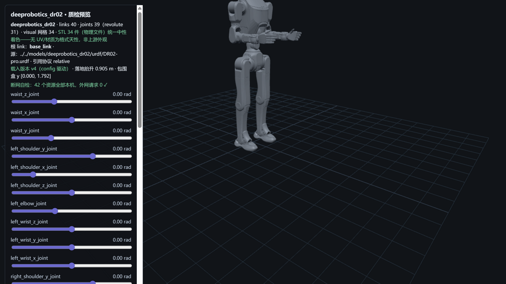

# deeprobotics_dr02 — 云深处 DR02 Pro（M6 · 人形 · 1.8 m 级库内最高）



> **管道预览页**渲染截图（`?model=deeprobotics_dr02`）——模型文件即本页所述入库件，零外网依赖；
> 同仓第三机型、**本库第 4 个人形机型**（G1/X2/T1 之后）与**云深处首个人形**、**1.8 m 级库内最高**；
> 选型证据=官网逐部位 DoF 分解与仓库配置逐位闭合（历次最强）；
> **包围盒 y [0.000, 1.792] ↔ 官网站立尺寸 1800 mm（−8 mm 零位/标称姿态差）**——人形模型首个身高官方对账点。

## Provenance（来源与授权）

| 项 | 值 |
|---|---|
| 单仓双源 | DeepRoboticsLab/deep_robotics_model @ `530e01a5d2ceb6007f8790f1a7e11ee7389fb981`（`DR02/` 子目录——与 M5 同 HEAD，活跃仓 pushed 2026-10-23，S1 对账零漂移） |
| License | **BSD-3-Clause**（整仓单 license，与 M2/M5 快照**逐字节同物** `cdc6c065`，R28 三重同物全验无新定性）。原文快照随文件入库：`LICENSE-upstream-deep_robotics_model.txt`；版权行 `Copyright (c) 2024, DeepRoboticsLab`（快照逐字，N1） |
| 官方性验证 | **继承 M2/M5 双路径全中**（同仓同 org，R14/R25 两轮在案）；官网 DR02 产品页（detail/5.html，"全球首款行业级全天候人形机器人"，静态 HTML 原件 148,398 B 落 evidence——**R28 轻度口径处置：sessionId 令牌脱敏 + 服务端字节保留**，详见口径注记）。详见 [SOURCE.md](SOURCE.md) |
| 入库对账 | **70 物理件 / 59.8 MB，三锚全过**（models↔manifest↔上游 blob id）+ 1 质检截图（S5 自产，不入三锚）；Pro 侧网格分目录（urdf/meshes 36 + mjcf/meshes 34，两侧同哈希）；excluded 3（fix_joints 锁死变体 + Standard 平替整组）——[S4-package.md](reports/S4-package.md) |
| 配对 | `DR02/urdf/pro/DR02-pro.urdf`（40 link / 31R+8F）↔ `DR02/mjcf/pro/DR02_pro.xml`（41 body/32 joint）——**官网 DoF 分解逐位背书**：主动 31 = 单臂 7×2 + 单腿 6×2 + 腰 3 + 头 2；Standard（21R/68kg）平替整组留 M6+，fix_joints 锁死变体不入库只记录 |
| 引用协议 | URDF **relative（`./meshes/` 显式前缀，36 处有效引用 → 34 物理件，大小写失配 0，scale 双侧 0）**；MJCF **meshdir 相对引用**（分目录自有池，closure 零改动落位）——**本库首个 collision 引用 mesh 的模型**（2 处，复用 visual 文件） |

## 使用

**MuJoCo 查看**

```bash
python -m mujoco.viewer --mjcf=models/deeprobotics_dr02/mjcf/DR02_pro.xml
```

**Python 加载**

```python
import mujoco
model = mujoco.MjModel.from_xml_path("models/deeprobotics_dr02/mjcf/DR02_pro.xml")
data = mujoco.MjData(model)
mujoco.mj_step(model, data)
```

**在线预览**：仓库根目录跑 `python -m http.server 8130`，打开
`http://127.0.0.1:8130/pipeline/s5_preview/index.html?model=deeprobotics_dr02`——31 关节滑条可交互；
STL 34 件（物理文件）统一中性着色；断网可用（42 资源全本机外网 0）。

## 质检结论

| 项 | 结果 |
|---|---|
| 格式校验（S2） | **10 PASS / 0 FAIL**：URDF 40 link/39 joint（根=base_link）、36 处有效引用 100% 解析 + 大小写失配 0、34 网格 trimesh 全读通；MJCF 编译 nbody=41/njnt=32/nq=38/**nu=31**（31 单自由度活动关节 ↔ 31 hinge，nq=31+free7 自洽） |
| 物理体检（S3） | **10 PASS / 3 WARN / 0 FAIL / 0 SKIP**（WARN 见披露）；两侧总量 **78.085 kg vs 官网 78 kg（+0.1%，历次最贴）且 URDF/MJCF 同值**；逐 body **34/34 完全一致**（无 M20 式分布分歧）+ **COM 34/34 差 0.00e+00**；31 对关节轴逐分量差 0；**官方 DoF 基准齐备**（本库首个：官网 31 分解 ↔ URDF 31R 逐位） |
| 基准（S6） | MuJoCo 步进 **110,257 steps/s**（9.1 µs/step）、加载 153.8 ms、展幅 3.4%——**超越 Go2 成七模型序列最快**（41 body 全基元碰撞：几何简单度主导步速，"跨模型不可比"再加固——最大人形反而最快） |
| 报告 | [reports/](reports/)——S1-fetch / S2-validation / S3-physics / S4-package / S6-benchmark |

## ⚠️ 已知分歧披露（质检的一部分，E1）

**本模型未做任何参数修改（零修复纯体检）**。以下如实披露：

### 1 · 引用计数口径更正（grep 39 → 解析器 36，L12 家族活案例）

- S1 侦察正则计得 **39 处 mesh 引用**，S2 lxml 解析实数 **36 处有效元素**（34 visual + 2 collision）——
  差 3 处系 **URDF 注释块内的禁用 mesh 引用**（head_link/left_ankle_x_link，上游注释掉的备选几何）。
- 处置：以解析器口径为准（唯一集不受影响，闭包 34 不变）；S1 正则口径在本页如实更正。
  **下游提示**：自行用正则/字符串法解析 URDF 时，注释内的元素会虚增引用计数——先过 XML 解析器再数。

### 2 · 本库首个 collision-mesh 模型（2 处 mesh 碰撞）

- URDF 碰撞体 28/40 link（cylinder 27/box 6/**mesh 2**/sphere 1）——**mesh 碰撞 2 处复用 visual 文件**
  （手部 link），Go2/G1 是全 mesh 碰撞、Lite3/M20/T1/X2 是全基元，DR02 为混合风格首例；
- 无 collision 的 12 link：双肩 y/双腕 x/双髋 x（相邻 link 覆盖，建模约定）+ 6 传感器座——标记不自动补。

### 3 · 身高对账的口径注记（人形首个官方身高基准）

- 官网"站立尺寸 约 1800×558×400 mm"为标称站姿；本库包围盒 y [0.000, 1.792] 为零位姿态
  （测量法=three.js Box3 逐 mesh AABB 并集，既定口径）——**−8 mm 差属姿态差而非误差**，
  人形零位（臂弯手张）与官方展示站姿不同；两侧数量级互证成立。

### 4 · 传感器座无惯量/无碰撞（普遍约定，WARN）

- 6 个 fixed 传感器座（d435_head/front/rear、lidar、imu_head/imu_base）无 `<inertial>`、无 `<collision>`；
  MJCF 同位 6 空 body——与 T1/X2/M20 同族约定，标记不自动补。

### 5 · 官网规格页 evidence 的 sessionId 脱敏（R28 轻度口径处置）

- 官网 detail/5.html 每次请求嵌一个变化的服务端 `sessionId`（40 位十六进制）；evidence 原件按
  R28 裁定以**二进制原件字节落档（148,398 B）+ 令牌值脱敏**（替换为占位符，−1 B）——
  正文参数事实（78 kg/DoF 分解/站立尺寸）不受影响；正文唯一差异行即令牌行。
  规格页正文其余部分与服务端字节逐位保留（K1/K2 行尾家族教训的正面执行）。

## 口径与来源注记

- 官网 DR02 Pro 参数表（`evidence/official-dr02-spec-page.html` 原件，sessionId 已脱敏）：
  整机重量（含电池）约 78 kg、站立尺寸约 1800×558×400 mm、主动自由度 31（单臂 7×2/单腿 6×2/腰 3/头 2）、
  持续负载 10 kg、IP66；Standard 版（21 DoF/68 kg）不入库只记录（M6+ 平替）。
- 上游漂移监控：pin `530e01a5`（与 M5 同 HEAD，S1 对账零漂移）；活跃仓，后续对账以本 pin 为准。
- 同仓其余机型与 booster K1/T2 线为 M7+ 候选，事实档案见 `workspace/m5_recon/`、`workspace/m6_recon/`（侦察件不入库）。
