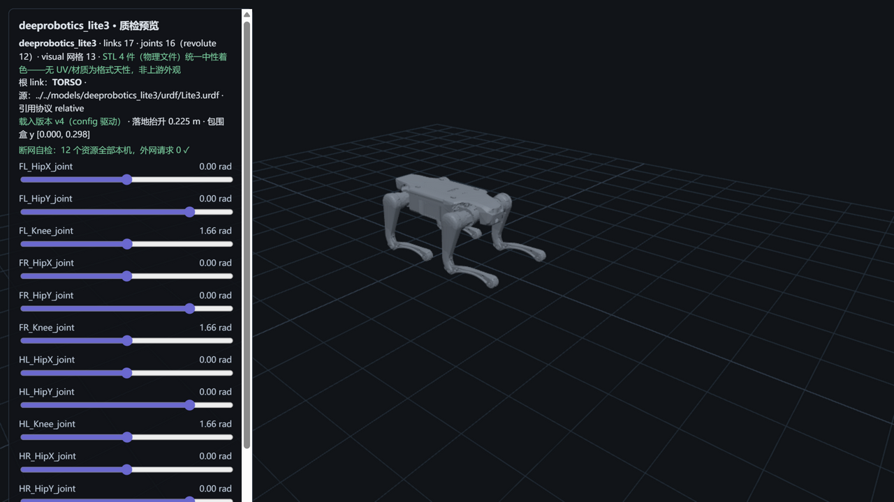

# deeprobotics_lite3 — 云深处 绝影 Lite3（M2 · 异厂泛化）



> **管道预览页**渲染截图（`?model=deeprobotics_lite3`）——模型文件即本页所述入库件，零外网依赖；
> 首次异厂收录：单仓双格式（unitree 为分仓模式）、引用协议第三变体（`./meshes/`）、碰撞全基元。
> **截图换版说明（R19）**：本页旧截图（v4 版）系本库预览器未应用 `<mesh scale>` 时的缺陷渲染产物
> （Lite3.urdf 6 处 scale 含 5 处镜像——hip/thigh 左右腿共用 STL 的镜像技巧未被应用，两腿同手性）；
> 现图（v8）为 scale + DoubleSide 修复后的正确渲染（四腿实心、左右镜像正确，AGENT-LAB L12 后续）。

## Provenance（来源与授权）

| 项 | 值 |
|---|---|
| 单仓双源 | DeepRoboticsLab/deep_robotics_model @ `75824b516ecc8fa3f8f7ce5d6577e1e86d6b614f`（`Lite3/`——同仓 `urdf/` + `mjcf/` 两子目录，与 unitree 分仓模式不同） |
| License | **BSD-3-Clause**（版权方按快照逐字 = **Copyright (c) 2024, DeepRoboticsLab**），原文快照随文件入库：`LICENSE-upstream-deep_robotics_model.txt`（1502 B） |
| 官方性验证 | **双路径全中（R14 复核升级）**：官网支持页 "DeepRoboticsLab(点击跳转GitHub)" 直链（`evidence/deeprobotics-support-page.html.txt`）+ org 四字段品牌互指（blog=deeprobotics.us / twitter / email）+ 非 fork——详见 [SOURCE.md](SOURCE.md) |
| 入库对账 | **10 文件 / 7.0 MB，三锚全过**（models↔manifest↔上游 blob id——K2 后口径，异厂首战零人工干预）；URDF 13 处引用 → 4 个物理 STL；excluded 5 件（usd/ 超范围）——[S4-package.md](reports/S4-package.md) |
| 引用协议 | **relative（`./meshes/` 显式前缀变体）**——第三种协议形态（Go2 package://、G1 无前缀 relative），build_plan 已规范化兼容 |

## 使用

**MuJoCo 查看（B4）**

```bash
python -m mujoco.viewer --mjcf=models/deeprobotics_lite3/mjcf/Lite3.xml
```

**Python 加载**

```python
import mujoco
model = mujoco.MjModel.from_xml_path("models/deeprobotics_lite3/mjcf/Lite3.xml")
data = mujoco.MjData(model)
mujoco.mj_step(model, data)
```

**在线预览**：仓库根目录跑 `python -m http.server 8130`，打开
`http://127.0.0.1:8130/pipeline/s5_preview/index.html?model=deeprobotics_lite3`——12 个关节滑条可交互；
STL 4 件（物理文件，13 处引用复用）统一中性着色；断网可用。

## 质检结论

| 项 | 结果 |
|---|---|
| 格式校验（S2） | 10 PASS / 0 FAIL：URDF 17 link/16 joint（根=TORSO）、13 处引用 100% 解析 + 大小写核验失配 0、MJCF 编译通过（**注意：官方 asset 段 13 个 mesh 元素引 4 物理件，重复定义 MuJoCo 不报错、nmesh 虚胖**——入库 xml 原样保留，引用行 ≠ 文件数） |
| 物理体检（S3） | **10 PASS / 1 WARN / 1 FAIL / 1 SKIP**——FAIL 见下方披露（本库首个 FAIL 级发现）；两侧质量逐 body **17/17 完全一致**、总量 vs 官网仅 −0.5%（三模型最贴） |
| 基准（S6） | MuJoCo 步进 **47,966 steps/s**（20.8 µs/step）、加载 59.2 ms、展幅 4.9%——与 Go2 同 DOF 却差 2.2 倍（geom 复杂度主导，跨模型不可比再实证） |
| 报告 | [reports/](reports/)——S2-validation / S3-physics / S4-package / S6-benchmark（md + json） |

## ⚠️ 已知分歧披露（质检的一部分，E1）

**本模型未做任何参数修改（零修复纯体检）**。以下如实披露：

### 1 · FAIL：四个足端 link 惯量张量全零（本库首个 FAIL 级发现）

- `FL/FR/HL/HR_FOOT` 四件惯量张量 **ixx=iyy=izz=ixy=ixz=iyz=0.0**（质量均 0.02 kg、四足格式规整一致）
  ——**上游有意的零惯量占位约定**（足端质量小、惯量按零处理），非数据笔误。
- **下游影响提示**：零惯量 + 非零质量的 body 在部分引擎会被自动估算或告警，做 RL/控制的
  同学引用此 URDF 时注意足端动力学与真实物理的偏差；MJCF 侧同位置表达见 [S3-physics.md](reports/S3-physics.md)。
- **零修复**（改官方文件违反本库立场；如需正定化方案属派生版本范畴，另行讨论）。

### 2 · MJCF mesh 元素重复定义（引用行 ≠ 文件数的 MJCF 版）

官方 `Lite3.xml` asset 段含 **13 个 `<mesh>` 元素引 4 个物理文件**（同名多定义），MuJoCo 编译
不报错但 nmesh=13 虚胖。入库 xml 原样保留（不改官方一字节），入库网格闭包按物理文件 4 件。

### 3 · 碰撞全基元（厂商风格差异）

URDF 碰撞体全部为 box/cylinder/sphere 基元（无 mesh collision——与 Go2/G1 的 mesh 碰撞风格
不同）；`usd/` 目录（5 件）超出本库 URDF/MJCF 范围 excluded。

### 4 · 上游 2026-08-21 更新注记转述（R25 裁定③补记，2026-10-24）

上游根 README"Lite3 model update (2026-08-21)"节自述：本机型 URDF 与 MJCF/USD 的
**thigh centers of mass（大腿质心）存在差异**（OEM 格式特有数据）。本库 M2 对账范围为质量总量
与逐 body mass（17/17 一致），**COM 不在当期对账范围**——本条为上游自述的如实转述，不动 M2
质检记录本体；同仓 M20（deeprobotics_m20）自 M5 起管道已增设逐 body COM 对账（R25 裁定②）。

## 质量口径（官网原文实证）

官网产品页明示 **"重量（带电池）12kg"**、站立尺寸 610×370×406 mm（截图
`evidence/official-lite3-spec-page-screenshot-{1..4}.png`）。本入库的 URDF/MJCF 均无电池 link——
严格口径不可比，总量对比（−0.5%）仅作 sanity 参考。**官网未公布关节级参数（扭矩/限位/自由度数）**
——限位对账无官网基准，纯体检+披露；页面四版本（基础/探索/专业/激光）默认显示基础版口径。

## 文件清单

```
urdf/           Lite3.urdf（官方件）
urdf/meshes/    URDF 引用闭包网格（stl×4，relative ./ 前缀协议与 urdf 同目录）
mjcf/           Lite3.xml（官方件；无独立 scene 包装，S6 复验即模型本体）
mjcf/meshes/    MJCF 网格闭包（stl×4，与 urdf 侧同哈希——同源同内容）
images/         预览页截图
reports/        S2/S3/S4/S6 质检报告（md + json）
SOURCE.md       来源/license/官方性证据链全记录（A4 双路径、N1 版权行在案）
LICENSE-upstream-deep_robotics_model.txt   上游 BSD-3 原文快照（义务随文件走）
```

**商标声明**：Deep Robotics / 绝影 / Lite3 为云深处科技商标；本项目非官方、无关联、无背书。
