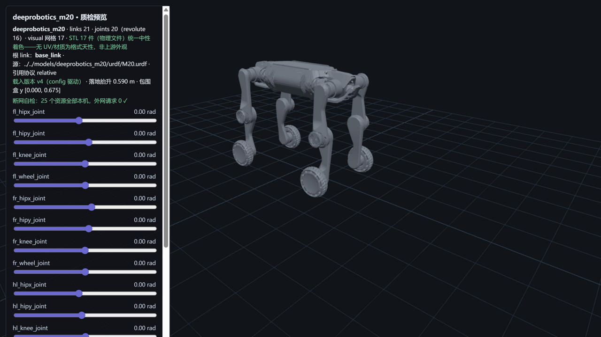

# deeprobotics_m20 — 云深处 山猫 M20（M5 · 同仓第二机型 · 轮足形态）



> **管道预览页**渲染截图（`?model=deeprobotics_m20`）——模型文件即本页所述入库件，零外网依赖；
> 同仓第二机型（Lite3 之后）、**管道首个 continuous 关节拓扑**（4 轮无限位关节，URDF continuous ↔
> MJCF unlimited hinge 映射 S1–S2 定案）；引用协议与 Lite3 同款（`./meshes/` 显式前缀）。
> 包围盒 y [0.000, 0.675]（零位姿态；官网"站立尺寸 约 820×430×570 mm"为标称站姿口径，两者不可直比——如实注记）。

## Provenance（来源与授权）

| 项 | 值 |
|---|---|
| 单仓双源 | DeepRoboticsLab/deep_robotics_model @ `530e01a5d2ceb6007f8790f1a7e11ee7389fb981`（`M20/` 子目录——活跃仓 pushed 2026-10-23，S1 对账零漂移；树 422 件 truncated=False） |
| License | **BSD-3-Clause**（整仓单 license，与 M2 Lite3 **同仓同快照逐字节同物** `cdc6c065`，R25 三重同物全验无新定性）。原文快照随文件入库：`LICENSE-upstream-deep_robotics_model.txt`；版权行 `Copyright (c) 2024, DeepRoboticsLab`（快照逐字，N1） |
| 官方性验证 | **继承 M2 Lite3 双路径全中**（官网支持页直链 + org 互证，R14 复核升级）——同仓同 org 同 license，无新增阴性项；M20 官网产品页 `deeprobotics.cn/products/detail/1.html`（山猫 M20 系列，静态 HTML 可提取，原件 evidence/official-m20-spec-page.html）。详见 [SOURCE.md](SOURCE.md) |
| 入库对账 | **36 物理件 / 23.9 MB，三锚全过**（models↔manifest↔上游 blob id）+ 1 质检截图（S5 自产，不入三锚）；**网格按格式分目录**（urdf/meshes/ 17 + mjcf/meshes/ 17，两侧同哈希同物）+ urdf + xml；excluded 5（usd/ 件，Lite3 M2 先例）——[S4-package.md](reports/S4-package.md) |
| 配对 | `M20/urdf/M20.urdf`（21 link / 20 joint）↔ `M20/mjcf/M20.xml`（同名直配）；M20S/S10/M20_Piper/DR02/X30 同仓其余机型不入库只记录（M5+ 候选） |
| 引用协议 | URDF **relative（`./meshes/` 显式前缀，17 引=17 唯一，大小写失配 0，scale 0）**；MJCF **`meshdir="./meshes/"` + 裸文件名**（分目录自有网格池，closure 零改动落位） |

## 使用

**MuJoCo 查看**

```bash
python -m mujoco.viewer --mjcf=models/deeprobotics_m20/mjcf/M20.xml
```

**Python 加载**

```python
import mujoco
model = mujoco.MjModel.from_xml_path("models/deeprobotics_m20/mjcf/M20.xml")
data = mujoco.MjData(model)
mujoco.mj_step(model, data)
```

**在线预览**：仓库根目录跑 `python -m http.server 8130`，打开
`http://127.0.0.1:8130/pipeline/s5_preview/index.html?model=deeprobotics_m20`——**16 个滑条**
（12 限位关节 + 4 轮关节 continuous ±π 语义）；STL 17 件（物理文件）统一中性着色；
断网可用（25 资源全本机外网 0）。

## 质检结论

| 项 | 结果 |
|---|---|
| 格式校验（S2） | **10 PASS / 0 FAIL**：URDF 21 link/20 joint（根=base_link；12 revolute+4 continuous+4 fixed）、17 引用 100% 解析 + 大小写失配 0；MJCF 编译 nbody=18/njnt=17/nq=23/**nu=16**（16 单自由度活动关节 ↔ 16 hinge，nq=16×1+free7 自洽） |
| 物理体检（S3） | **10 PASS / 3 WARN / 0 FAIL / 1 SKIP**（WARN 见披露）；两侧总量 34.491/34.526 kg vs **官网"整机重量（含电池）约 35 kg"（−1.5%/−1.4%，容差内）**；逐 body **COM 对账 17/17 全一致**（R25 裁定②新增检查，最大差 4.99e-07）；16 对关节轴逐分量差 0 |
| 基准（S6） | MuJoCo 步进 **43,867 steps/s**（22.8 µs/step）、加载 62.3 ms、展幅 12.0%——六模型序列第四点（Go2 105k / G1 51k / Lite3 48k / X2 39k / T1 36.8k），18 body/45 geom，**跨模型数字不可比**再实证 |
| 报告 | [reports/](reports/)——S1-fetch / S2-validation / S3-physics / S4-package / S6-benchmark |

## ⚠️ 已知分歧披露（质检的一部分，E1）

**本模型未做任何参数修改（零修复纯体检）**。以下如实披露：

### 1 · URDF↔MJCF 腿部质量分布分歧（hipy −0.125 kg / knee +0.115 kg ×四腿——本模型核心质检发现）

- 逐 body 对账：4×hipx 与 5 个躯干类 body 完全一致；**四腿的 hipy 与 knee 质量两格式不一致**——
  URDF hipy 2.4930 / knee 1.2600 vs MJCF hipy 2.6180 / knee 1.1450（每腿 −0.125/+0.115 kg，
  四腿合计 −0.04 kg = 两侧总量差 34.526−34.491 自洽）。
- 定性：**上游格式间质量重分配**（非本库缺陷）——MJCF 总量更贴官方 35 kg 标称。**零修复如实披露**（M0 修正 6）。
- **下游影响提示**：做腿部动力学/控制设计时注意两格式的腿部惯量分布不可互换（与上游 README
  对 Lite3 的 thigh COM 注记同族现象——本模型的 COM 位置两格式逐位一致，仅质量值不同，见披露 2）。

### 2 · COM 逐位一致而质量分歧（R25 裁定②新增检查的发现）

- 本模型起管道新增 **URDF↔MJCF 逐 body COM 对账**（记录级 WARN，R25 裁定②）：17 个有质量 body
  的质心位置**全部一致**（最大逐分量差 4.99e-07）——即上游在两格式间只改了质量值、未动质心原点。
- 与上游对 Lite3 的注记（"thigh centers of mass differ between URDF and MJCF/USD"）对照：
  Lite3 是 COM 有差、M20 是 COM 无差而质量有差——**同仓两机型呈现互补的格式差异模式**，
  转移配置到不同模拟器时都需核对（上游 README 原话"Check these differences when transferring
  configurations between simulators"）。

### 3 · 官网未公布自由度与关节级参数（Lite3 同口径）

- 官网参数表明示"更多接口、配置与交付信息，请下载中文产品单页"——自由度/关节扭矩未公布，
  S3 限位/扭矩对账无官网基准，纯体检+披露；**DoF 口径改用模型侧三方互证**：URDF 16 单自由度
  活动关节（12R+4C）↔ MJCF nu=16 ↔ nq=23（16+free7）自洽。
- 站立尺寸官网口径 820×430×570 mm 为标称站姿；本库包围盒 y [0.000, 0.675] 为零位姿态
  （测量法=AABB 并集，见披露 5）——两者姿态不同不可直比，如实注记。

### 4 · 传感器座无惯量/无碰撞 + 碰撞全基元（普遍约定，WARN）

- 4 个 fixed 传感器座（front/rear_camera_link、front/rear_lidar_link）无 `<inertial>`、无 `<collision>`
  （17/21 link 有碰撞体，全基元 box 9/cylinder 18，零 mesh 碰撞）——与 T1/X2 同族建模约定，标记不自动补。

### 5 · 包围盒测量法注明（R20 挂账既定口径）

- 本库 bbox 测量法 = **three.js Box3 逐 mesh AABB 并集（保守口径）**；页面读数 y [0.000, 0.675]、
  落地抬升 0.590 m（自 M5 起各模型页沿用此注记口径，R20 观察项已于 R23 关闭）。

## 口径与来源注记

- 官网 M20 系列参数表（2026-10-24 抓取，`evidence/official-m20-spec-page.html` 原件）：
  M20 整机重量（含电池）约 35 kg、站立尺寸约 820×430×570 mm、持续负载 15 kg、极限速度 5 m/s、
  IP66；M20S 为独立机型（36 kg/负载 35 kg/9 m/s——**同仓 M20S/ 目录为该机型，不入库只记录**）。
  本库锚定 **M20 标准版**。
- 上游漂移监控：pin `530e01a5`（2026-10-23 push，S1 对账零漂移）；活跃仓，后续对账以本 pin 为准。
- 同仓其余机型（M20S/S10/M20_Piper/DR02 人形/X30）为 M5+ 候选，事实档案见
  `workspace/m5_recon/dr_model_facts.json`（侦察件不入库）。
