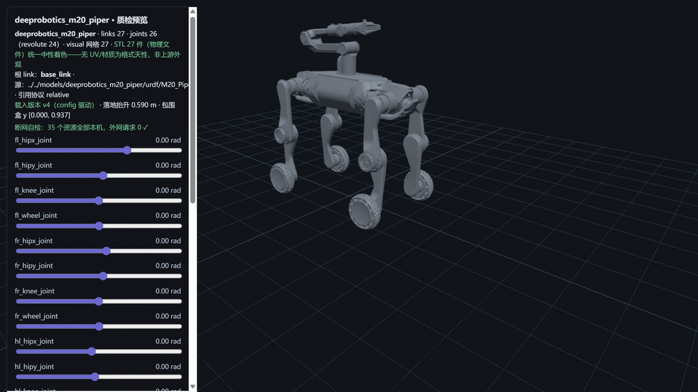

# deeprobotics_m20_piper — 云深处 M20_Piper（M9 · 移动操作复合体 · prismatic 拓扑收官）



> **管道预览页**渲染截图（`?model=deeprobotics_m20_piper`）——模型文件即本页所述入库件，零外网依赖；
> 同仓第四机型、**复合体谱系首例**（M20 轮足底盘 + Piper 臂 = 移动操作 loco-manipulation 平台）；
> **prismatic↔slide 映射定案=管道六关节类型收官**（revolute/continuous/fixed/prismatic/free/floating 全覆盖）；
> **上游数据缺陷 FAIL（本库第三个 FAIL 级发现）**：URDF 限位含全角句号 `0。611`，yourdfpy 加载即失败——
> 详见披露 1（引用此模型前必读）。

## Provenance（来源与授权）

| 项 | 值 |
|---|---|
| 单仓双源 | DeepRoboticsLab/deep_robotics_model @ `530e01a5d2ceb6007f8790f1a7e11ee7389fb981`（`M20_Piper/`——与 M5/M6 同 HEAD 零漂移） |
| License | **BSD-3-Clause**（整仓单 license，与 M2/M5/M6 快照**逐字节同物** `cdc6c065`，R37 四重同物全验无新定性）。原文快照随文件入库：`LICENSE-upstream-deep_robotics_model.txt`；版权行 `Copyright (c) 2024, DeepRoboticsLab`（快照逐字，N1） |
| 官方性验证 | **继承 M2/M5/M6 三轮双路径先例**（同仓同 org 第四机型）；README 八机型表含 M20_Piper 行；Piper 臂为云深处组件产品线（组件分类页在导航——**独立整机产品页确认无**，R37 轻度口径处置在案，evidence 原件已按实更名 `official-robot-component-index-page.html`）。详见 [SOURCE.md](SOURCE.md) |
| 入库对账 | **56 物理件 / 42.3 MB，三锚全过**（models↔manifest↔上游 blob id）+ 1 质检截图（S5 自产，不入三锚）；分目录网格（urdf/meshes 27 + mjcf/meshes 27，两侧同哈希）；**平账 61=56+5 usd excluded，未收为零**——[S4-package.md](reports/S4-package.md)（**recheck-urdf FAIL 如实落表**，见披露 1） |
| 配对 | `M20_Piper.urdf`（27 link / 18R + 4C + **2 prismatic** + 2F）↔ `M20_Piper.xml`（28 body/25 joint，22 hinge + **2 slide**）——**prismatic↔slide 映射定案**（夹爪双指 joint7/8 平移 ±0.035 m）；usd 5 件不入库（M20/M2 先例） |
| 引用协议 | URDF **relative（`./meshes/` 显式前缀，37 引 → 27 物理件，大小写失配 0，scale 双侧 0）**；MJCF **meshdir 相对引用**（分目录自有池，closure 零改动落位） |

## 使用

**MuJoCo 查看**（MJCF 侧不受披露 1 缺陷影响，可正常使用）

```bash
python -m mujoco.viewer --mjcf=models/deeprobotics_m20_piper/mjcf/M20_Piper.xml
```

**Python 加载**

```python
import mujoco
model = mujoco.MjModel.from_xml_path("models/deeprobotics_m20_piper/mjcf/M20_Piper.xml")
data = mujoco.MjData(model)
mujoco.mj_step(model, data)
```

**在线预览**：仓库根目录跑 `python -m http.server 8130`，打开
`http://127.0.0.1:8130/pipeline/s5_preview/index.html?model=deeprobotics_m20_piper`——
**24 个滑条（22 rad + 2 夹爪平移 m）**；STL 27 件统一中性着色；断网可用（35 资源全本机外网 0）。

## 质检结论

| 项 | 结果 |
|---|---|
| 格式校验（S2） | **9 PASS / 1 FAIL / 0 WARN**：URDF 27 link/26 joint（根=base_link；18R+4C+2P+2F）、37 处引用 100% 解析 + 大小写失配 0、27 网格 trimesh 全读通；**yourdfpy-parse FAIL 见披露 1**（上游数据缺陷）；MJCF 编译 nbody=28/njnt=25/nq=31/**nu=24**（24 单自由度活动关节 ↔ 22 hinge+2 slide 逐数自洽） |
| 物理体检（S3） | **9 PASS / 3 WARN / 1 FAIL / 0 SKIP**：**41.994→39.161 kg 实测仅记录**（官方整机基准缺失=T1 式处置，复合体无整机产品页）；逐 body **23/23 完全一致 + 4 项舍入级约定差异**（四 hipx −0.0000）+ **COM 27/27 差 4.79e-08 全一致**；22 对关节轴逐分量差 0；**joint-limits FAIL 见披露 1**（同根） |
| 基准（S6） | MuJoCo 步进 **93,447 steps/s**（10.7 µs/step）、加载 105.5 ms、展幅 10.3% 一次过——**九模型序列第三**（28 body/64 geom 但碰撞结构简单，复杂度主导再实证） |
| 报告 | [reports/](reports/)——S1-fetch / S2-validation / S3-physics / S4-package / S6-benchmark |

## ⚠️ 已知分歧披露（质检的一部分，E1）

**本模型未做任何参数修改（零修复纯体检）**。以下如实披露：

### 1 · FAIL：URDF 限位含全角句号 `0。611`（本库第三个 FAIL 级发现——上游数据缺陷，引用前必读）

- 上游 URDF **L70 `fl_hipx_joint`（左前腿髋侧摆）的 limit `upper="0。611"`**——小数点误录为中文全角句号
  （应为 `0.611`），全文件仅此 1 处；**交叉证据：MJCF 侧同名限位为正常半角 `-0.436 0.611`**（上游两格式
  独立书写，URDF 侧 typo 实锤）；
- **影响面（同根 typo 三处检查点表现）**：①S2 `yourdfpy-parse` FAIL——**yourdfpy 加载整个 URDF 即抛
  ValueError，yourdfpy 用户无法使用本 URDF**；②S3 `joint-limits` FAIL——该关节限位非数值（其余 17 关节
  正常，管道容错后如实点名）；③S4 `recheck-urdf` FAIL——入库后加载验证同样失败（验证对象即加载行为，
  不做容错如实保留）；**MJCF 侧完全不受影响**（MuJoCo 用户正常使用）；
- **零修复**：模型文件一字未动（本库红线）；**下游影响提示**：yourdfpy/严格解析器用户需自行将该字符
  替换为半角后使用（一行文本替换）；MuJoCo/Isaac 系走 MJCF 的用户不受影响。

### 2 · prismatic↔slide 映射定案（管道六关节类型收官）

- 夹爪双指 `joint7`/`joint8`（prismatic，axis ±z，限位 ±0.035 m，effort 10）↔ MJCF `type="slide"`
  逐字对应（range 同值 limited=true）——**管道六关节类型 revolute/continuous/fixed/prismatic/free/floating
  全覆盖收官**（M5 continuous 之后的第二块拼图）；
- 预览页 prismatic 滑条以**米为单位**（22 rad + 2 m 共 24 滑条），拖动即夹爪开合平移
  （预览器 prismatic 支持为本模型落码，N2 备案）。

### 3 · 官方整机基准缺失（T1 式处置第二例）与基准分层

- 复合体无整机产品页（Piper 臂为组件产品线，组件分类页零 Piper 字样实测在案——evidence 原件已按实
  更名 `official-robot-component-index-page.html`）；整机质量对比**跳过并 WARN**（T1 先例），
  实测 39.161 kg **仅记录非判据**；
- **可参考分层**：M20 底盘官网 35 kg（M5 已锚定）+ Piper 臂自重（组件页无参数）——合成不可直接对账，
  如实分层披露；关节数对账=模型侧互证（22 活动关节三方一致）。

### 4 · 碰撞与惯量健康度（本库最干净一档）

- **27/27 link 全有 collision**（box 9/cylinder 18/mesh 10）——**无 collision 的 link 为零**（九模型首个
  全覆盖）；27 有质量 link 惯量全正定+三角不等式全成立；逐 body 质量 23/23 一致 + 四 hipx 舍入级差异
  （−0.0000）；COM 27/27 差 4.79e-08。

### 5 · 包围盒测量法注明（既定口径）

- 本库 bbox 测量法 = three.js Box3 逐 mesh AABB 并集；页面读数 y [0.000, **0.937**]、落地抬升 0.590 m
  （复合体站姿 0.94 m 级，介于 M20 0.675 与 K1 0.955 之间——臂部抬升贡献）。

## 口径与来源注记

- 官网组件分类页（`evidence/official-robot-component-index-page.html` 原件，60,233 B，sessionId 已脱敏）：
  组件产品线列表（**零 Piper 整机字样**，独立整机页确认无——R37 轻度口径处置记录）。
- 上游漂移监控：pin `530e01a5`（与 M5/M6 同 HEAD，S1 对账零漂移）；活跃仓，后续对账以本 pin 为准。
- 同仓 X30（scale 实战线+56 kg 基准）、DR02 Standard、M20S/S10 等维持 M9+ 档案
  （`workspace/m9_recon/` 侦察件不入库）。
