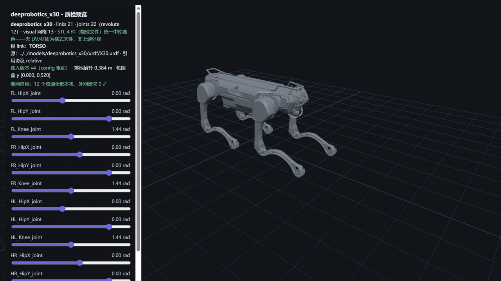

# deeprobotics_x30 — 云深处 绝影 X30（M10 · 工业四足 56 kg · scale 实战线）



> **管道预览页**渲染截图（`?model=deeprobotics_x30`）——模型文件即本页所述入库件，零外网依赖；
> 同仓第五机型、**本库最大质量四足**（56 kg，vs Go2 8.2/Lite3 12 档）；
> **scale 实战线**：URDF 5 处镜像技巧 + MJCF 4 处（**跨格式 scale 对账首例素材**）——
> R18/R19 修复后 preview.js scale 应用能力的首次成规模实战检验（四腿镜像渲染正确，见披露 2）；
> **包围盒 y [0.000, 0.520]**（四足趴姿零位）。

## Provenance（来源与授权）

| 项 | 值 |
|---|---|
| 单仓双源 | DeepRoboticsLab/deep_robotics_model @ `530e01a5d2ceb6007f8790f1a7e11ee7389fb981`（`X30/`——与 M5/M6/M9 同 HEAD 零漂移） |
| License | **BSD-3-Clause**（整仓单 license，与 M2/M5/M6/M9 快照**逐字节同物** `cdc6c065`，R40 五重同物全验无新定性）。原文快照随文件入库：`LICENSE-upstream-deep_robotics_model.txt`；版权行 `Copyright (c) 2024, DeepRoboticsLab`（快照逐字，N1） |
| 官方性验证 | **继承 M2/M5/M6/M9 四轮双路径先例**（同仓同 org 第五机型）；官网 X30 产品页（detail/6.html，"绝影X30"，141,318 B 二进制原件落 evidence——R29 取证范式**脱敏 1 处 token**）；README 八机型表含 X30 行。详见 [SOURCE.md](SOURCE.md) |
| 入库对账 | **10 物理件 / 8.4 MB，三锚全过**（models↔manifest↔上游 blob id）+ 1 质检截图（S5 自产，不入三锚）；**本库最轻入库**；分目录网格（urdf/meshes 4 + mjcf/meshes 4，两侧同哈希）；usd 5 件 excluded（M20/M9 先例）——[S4-package.md](reports/S4-package.md) |
| 配对 | `X30.urdf`（21 link / 12R + 8F）↔ `X30.xml`（22 body/12 joint）——**本库最小资产池**（4 网格：torso/hip/thigh/shank 基础件复用）；usd 5 件不入库（M20/M9 先例） |
| 引用协议 | URDF **relative（`./meshes/` 显式前缀，13 引 → 4 物理件，大小写失配 0）**；MJCF **`meshdir="./meshes/"` 相对引用**（分目录自有池，closure 零改动落位） |

## 使用

**MuJoCo 查看**（MJCF 侧 nu=0 无执行器，见披露 3——查看渲染正常）

```bash
python -m mujoco.viewer --mjcf=models/deeprobotics_x30/mjcf/X30.xml
```

**Python 加载**

```python
import mujoco
model = mujoco.MjModel.from_xml_path("models/deeprobotics_x30/mjcf/X30.xml")
data = mujoco.MjData(model)
mujoco.mj_step(model, data)
```

**在线预览**：仓库根目录跑 `python -m http.server 8130`，打开
`http://127.0.0.1:8130/pipeline/s5_preview/index.html?model=deeprobotics_x30`——12 关节滑条可交互；
STL 4 件（物理文件）统一中性着色；断网可用（12 资源全本机外网 0）。

## 质检结论

| 项 | 结果 |
|---|---|
| 格式校验（S2） | **10 PASS / 0 FAIL / 0 WARN**：URDF 21 link/20 joint（根=TORSO；12R+8F）、13 处引用 100% 解析 + 大小写失配 0、4 网格 trimesh 全读通（最小顶点 31,752——极简池但单件精细）；MJCF 编译 nbody=22/njnt=12/nq=12/**nu=0**（**无执行器模型=本库首例**，见披露 3） |
| 物理体检（S3） | **10 PASS / 3 WARN / 0 FAIL / 1 SKIP**：两侧总量 **55.839 kg vs 官网 56.0 kg（−0.3%）且 URDF/MJCF 同值**；逐 body **21/21 完全一致**；**COM 21/21 差 0.00e+00**；12 对关节轴逐分量差 0；**inertial rpy≠0 ×3**（hip 镜像系旋转惯量，sanity 全落区间） |
| 基准（S6） | MuJoCo 步进 **82,080 steps/s**（12.2 µs/step，R41 后重测三轮中位=正式序列数字；报告落盘 C 轮 83,218 同口径）——**我方窗口序列第五**（审核台交叉参照 119k/130k 系重置口径不入序列）；**展幅根因定案=连续复跑口径×nu=0 混沌轨迹段异质性**（R42 三重实验，见披露 3）；加载 61.8 ms |
| 报告 | [reports/](reports/)——S1-fetch / S2-validation / S3-physics / S4-package / S6-benchmark |

## ⚠️ 已知分歧披露（质检的一部分，E1）

**本模型未做任何参数修改（零修复纯体检）**。以下如实披露：

### 1 · 跨格式 scale 对账（本库首例——两侧均有 scale 的模型）

- **URDF 5 处**（全为镜像技巧，Lite3 R19 同族）：FR_HIP/FR_THIGH（`1 -1 1`）、HL_HIP（`-1 1 1`）、
  HR_HIP（`-1 -1 1`）、HR_THIGH（`1 -1 1`）——四腿 hip/thigh 两两共用 hip.STL/thigh.STL 翻转；
- **MJCF 4 处**（逐处定位 `<mesh>` 元素）：hip1（`1 -1 1`）/thigh1（`1 -1 1`）/hip2（`-1 1 1`）/
  hip3（`-1 -1 1`）；
- **对账真结论（S1 解析器口径钉案）**：hip 三镜像（FR/HL/HR）两侧逐位一致；**thigh 镜像分配两侧不完全
  一一对应**（URDF 给 FR/HR_THIGH 两处 `1 -1 1`，MJCF 仅 thigh1 一处）——两侧用不同的 mesh 定义复用
  策略表达同一几何（MJCF 借 name 复用），**镜像分配策略差异如实披露，几何渲染结果一致（S5 判据）**；
- 侦察期 grep 计数"4 处"曾漏报（正则形态差异），解析器/逐处提取口径修正为 4 处 mesh 元素 scale——
  R29 规程（正则仅线索、解析器为断言）再实战。

### 2 · 四腿镜像渲染判据（scale 实战检验通过）

- 预览页四腿由 4 网格 + 5 处 scale 镜像渲染：**左右腿形态对称、无镜像缺失/内翻/薄壳空心**（R19 判据），
  scale 应用（R18 修复）+ DoubleSide（R19 修复）在成规模镜像场景下实战通过；
- 极简池注意：仅 4 网格复用全机（torso/hip/thigh/shank），**单件精细度高**（最小顶点 31,752）。

### 3 · nu=0 无执行器模型（本库首例）与 S6 展幅根因定案（R42 三重实验闭合）

- **X30.xml 不含任何 `<actuator>`（nu=0）**——纯被动模型，本库首例（其余模型 nu≥12）；
  MuJoCo 加载/渲染正常，做动力学仿真需用户自行接控制器（结构性事实，S2 层面成立）；
- **S6 展幅根因定案（R42 三重实验闭合）**：**连续复跑口径 × nu=0 混沌轨迹段异质性**——
  `s6_bench.py` 的 5 个 rep 在同一条连续轨迹上推进（rep 间不重置）：nu=0 模型在纯重力下持续坍塌，
  每个 rep 覆盖不同混沌轨迹段→步进成本真实演化（reps 131,834→97,166→84,469 单调降后趋稳，
  审核台同进程控制变量实验 B 实测：连续口径 84,965/56.7% vs 每 rep 重置 **131,669/2.0%**；
  实验 A 脚本原样复现 85,397/59.4%；回归抽 2 go2 104,030/2.2%+dr02 109,940/2.5% 证明连续口径
  对稳定模型正常）——**展幅=真实轨迹演化信号，非测量噪声、非外源负载**；八轮 ~80k 一致亦由此
  解释（轨迹确定→段成本确定）；
- **数字口径**：**82,080（重测三轮中位，连续口径）为正式序列数字**（与十模型序列同口径可比，
  第四档 83k 成立；审核台 119~130k 系重置口径，仅根因证明用不入序列）；
- **方法论三条入档**：归因前必须做对照/确定性检验（R41）+归因前先核对实验口径本身（连续 vs
  重置，R42）+复现他人实验前必须读其实验代码原文（R42 审核台规程）；
- **下游影响提示**：直接用本 MJCF 跑控制仿真需先补 actuator 段（上游按 RL 工作流在训练侧定义）。

### 4 · 传感器挂载座与碰撞覆盖（约定项，WARN）

- 4 个 LIDAR 挂载座（FRONT_UP/DOWN/REAR_UP/DOWN）**带 1e-5 kg 占位惯量**（两侧逐位一致——
  R41 口径更正：非"无惯量"，系极小占位值）且无 geom（MJCF 同位空 body）；
  collision 13/21 link（全基元 cylinder 16/sphere 4/box 1），FL/FR/HL/HR_HIP 无碰撞（相邻覆盖）——
  与 DR02/M20 同族约定，标记不自动补；
- **inertial rpy≠0 ×3**（FR/HL/HR_HIP）——镜像腿的旋转惯量系，sanity 全落区间，如实记录（修正 1 口径）。

### 5 · 身高口径（趴姿零位）与对账

- 包围盒 y [0.000, **0.520**] 为零位趴姿（四足站姿高度远高于此——站立尺寸官网口径为站姿）；
  对账以质量为主（55.839 vs 56.0 kg，−0.3% 本库第二贴）；测量法=既定 AABB 并集口径。

## 口径与来源注记

- 官网 X30 参数表（`evidence/official-x30-product-page.html` 原件，141,318 B，sessionId 已脱敏）：
  整机重量（含电池）约 56 kg、持续运行负载 20 kg、负载续航约 2.5h、防护等级等。
- 上游漂移监控：pin `530e01a5`（与 M5/M6/M9 同 HEAD，S1 对账零漂移）。
- 同仓其余机型线（DR02 Standard/M20S/S10）维持"加 config 即加模型"档案；booster T2 手部双锚题
  维持专项档案（`workspace/m9_recon/`、`workspace/m10_recon/` 侦察件不入库）。
