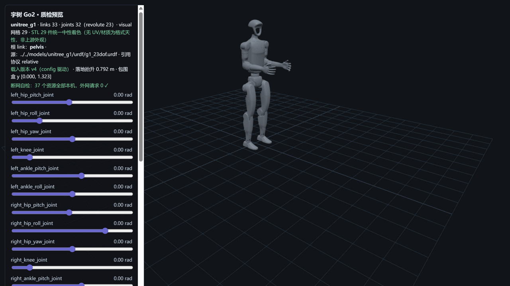

# unitree_g1 — 宇树 G1（M1 · 人形）



> **管道预览页**渲染截图（`?model=unitree_g1`）——模型文件即本页所述入库件，零外网依赖；
> 包围盒顶高 1.323 m ↔ 官网规格站立高 1320 mm（交叉验证吻合）。

## Provenance（来源与授权）

| 项 | 值 |
|---|---|
| URDF 源 | unitreerobotics/unitree_ros @ `5994d4faef0a9cadd3287f8de0199a67eeb2a259`（`robots/g1_description/`） |
| MJCF 源 | unitreerobotics/unitree_mujoco @ `1eb6642e3f3fdfb7fb13a9794fd6a2dd93ea0e7d`（`unitree_robots/g1/`） |
| License | **BSD-3-Clause**（版权方 = 杭州宇树科技），原文快照随文件入库：`LICENSE-upstream-unitree_ros.txt` / `LICENSE-upstream-unitree_mujoco.txt` |
| 官方性验证 | 同 org（unitreerobotics）复核 M0 双证据链 + 本日 head/API 原件 7 件存 `evidence/`（详见 [SOURCE.md](SOURCE.md)） |
| 入库对账 | **62 文件 / 40.5 MB，三锚全过**（models 件 SHA256 命中 manifest 同路径行 + hash-object 命中上游 ls-tree@pin blob id——R11-K2 后口径）；URDF 50 处引用 → 29 个物理 STL；excluded 228 件逐件带 why——[S4-package.md](reports/S4-package.md) |
| 引用协议 | **relative**（G1 的 URDF 用相对路径 `meshes/xxx.STL`，入库保持 meshes/ 与 urdf 同目录——与 Go2 的 package:// 布局不同） |

## 使用

**MuJoCo 查看（B4）**

```bash
python -m mujoco.viewer --mjcf=models/unitree_g1/mjcf/g1_23dof.xml
```

**Python 加载**

```python
import mujoco
model = mujoco.MjModel.from_xml_path("models/unitree_g1/mjcf/g1_23dof.xml")
data = mujoco.MjData(model)
mujoco.mj_step(model, data)
```

**在线预览**：仓库根目录跑 `python -m http.server 8130`，打开
`http://127.0.0.1:8130/pipeline/s5_preview/index.html?model=unitree_g1`——23 个关节滑条可交互，
拖出 URDF 限位会标红；STL 29 件统一中性着色（无 UV/材质为格式天性，如实标注非上游外观）；
断网可用（页面自检外网请求为 0）。

## 质检结论

| 项 | 结果 |
|---|---|
| 格式校验（S2） | 10 PASS / 0 FAIL：URDF 33 link/32 joint（根=pelvis）、50 处引用 100% 解析 + **引用名与磁盘真名大小写逐字节核验失配 0**、MJCF MuJoCo 编译通过 |
| 物理体检（S3） | 7 PASS / 5 WARN / 0 FAIL：惯量 29 link 全正定+三角不等式成立、sanity 全落区间、23 revolute 限位完整 |
| 基准（S6） | MuJoCo 步进 **50,809 steps/s**（19.7 µs/step）、加载 102.8 ms、URDF 解析 4.7 ms、展幅 2.3%（跨模型数字不可比，本机同口径内自洽） |
| 报告 | [reports/](reports/)——S2-validation / S3-physics / S4-package / S6-benchmark（md + json） |

## ⚠️ 已知分歧披露（质检的一部分，E1）

**本模型未做任何参数修改（零修复纯体检）**。以下如实披露：

### 1 · 官方文件名与自由度不符：`g1_23dof.xml` 实为 29 关节

- URDF 侧 `g1_23dof.urdf` = **23 revolute**（↔ 官网规格"总自由度 23"精确自洽）；
  MJCF 侧同名的 `g1_23dof.xml` 实测 **29 hinge** = 23 + 腰 pitch/roll（2）+ 双腕 pitch/yaw（4）。
- **下游影响提示**：做强化学习/控制的同学注意——URDF 动作空间 23 维、MJCF 29 维，
  **两套模型的动作空间不可互换**，选型时以你所用引擎的对应文件为准，并核对版本。
- 侧证：MJCF 侧 meshes/ 池 60 件中 23dof.xml 只引 29 件，其余 31 件为 29dof/手部/腰部
  网格（`left/right_hand_*`、`waist_*`、`torso_constraint_*`）——上游以同一网格池服务多配置。

### 2 · torso 质量 −1.28 kg：建模拆分差异，且有网格证据链闭环

- URDF torso 8.562 kg vs MJCF torso 9.842 kg。URDF 独有件合计 1.283 kg
  （head_link 1.036 + waist_yaw_fixed 0.244 + logo/pelvis_contour/waist_support 各 0.001）
  ——与差值 1.280 差 0.003 kg（= 两模型总质量差 34.137−34.134）。**逐克闭环**。
- **S4 网格证据**：两侧 29 件网格 28 件同哈希（同源同内容），唯一异哈希件 =
  **head_link.STL**（URDF 932,784 B 精细头壳 vs MJCF 337,584 B 简化版）——
  质量拆分分歧与网格差异是上游同一建模决策（URDF 独立头壳建模）的两个侧面。
- 总质量：URDF 34.134 / MJCF 34.137（仅差 0.003 kg）——两侧均为无电池口径（见下节），
  不存在"谁更贴官方"的方向性结论。零修复。

### 3 · 约定差异群（WARN，均有处置记录）

4 个 fixed 传感器座无 `<inertial>`（imu×2/d435/mid360，各引擎普遍合并）；6 link 无
`<collision>`（含 pelvis 本体，上游选择）；MJCF 6 个自闭合空 body（腰/腕铰链占位）。
详见 [S3-physics.md](reports/S3-physics.md) forensics 段。

## 质量口径（官网原文实证）

官网规格表明示 **"带电池重量 约35kg"**（截图 `evidence/official-g1-spec-page-screenshot-{1..4}.png`
+ 渲染文本 `official-g1-spec-page.txt`）。本入库的 URDF/MJCF **均不含电池 link**——与官网口径
严格不可比，总质量对比（两侧均 −2.5%）仅作 sanity 参考。
附带实证：官网"总自由度（关节电机）23" ↔ URDF 23 revolute；"膝关节最大扭矩 90N.m"（脚注[1]：
整机口径下最大关节电机）——S3 限位对账基准（腰 Z±155°/膝 0~165°/髋 P±154°、R-30~+170°、Y±158°）随报告在档。

## 文件清单

```
urdf/           g1_23dof.urdf（官方件；上游同目录 33 个模型文件=23 配置，本库收 23dof 配对）
urdf/meshes/    URDF 引用闭包网格（stl×29，relative 协议与 urdf 同目录）
mjcf/           g1_23dof.xml + scene_23dof.xml（官方 meshdir 相对结构原样保留）
mjcf/meshes/    MJCF 网格闭包（stl×29，池 60 件中 23dof 引用面）
images/         官方渲染图（g1_23dof.png）+ 预览页截图
reports/        S2/S3/S4/S6 质检报告（md + json）
SOURCE.md       来源/license/官方性证据链全记录（J1 变体计数、A2 复查、K2 归正在案）
LICENSE-upstream-*.txt   上游 BSD-3 原文快照（义务随文件走）
```

**商标声明**：Unitree / G1 为宇树科技商标；本项目非官方、无关联、无背书。
