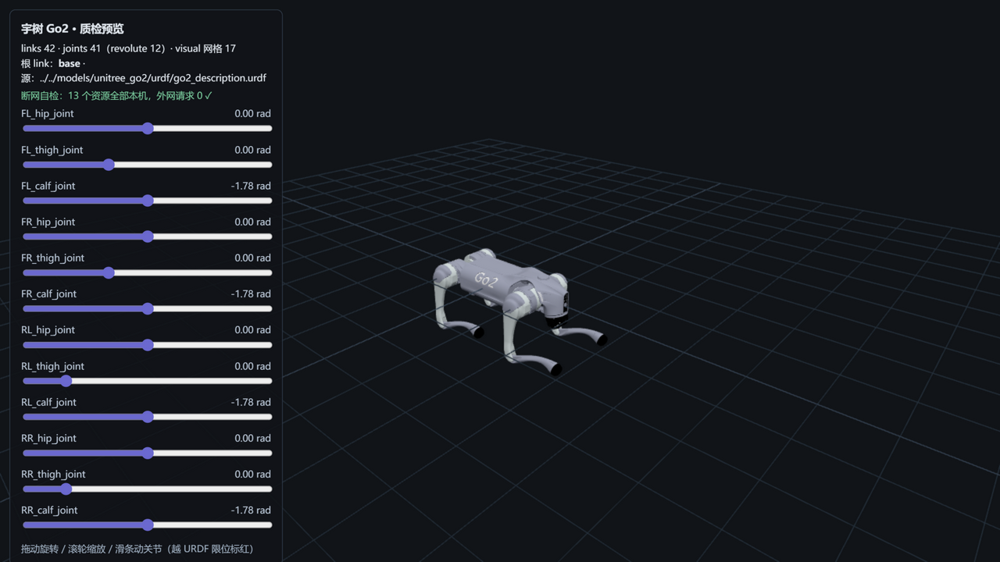

# unitree_go2 — 宇树 Go2（M0 质检样板）



> **管道预览页**渲染截图——模型文件即本页所述入库件，零外网依赖。

## Provenance（来源与授权）

| 项 | 值 |
|---|---|
| URDF 源 | unitreerobotics/unitree_ros @ `5994d4faef0a9cadd3287f8de0199a67eeb2a259`（`robots/go2_description/`） |
| MJCF 源 | unitreerobotics/unitree_mujoco @ `1eb6642e3f3fdfb7fb13a9794fd6a2dd93ea0e7d`（`unitree_robots/go2/`） |
| License | **BSD-3-Clause**（版权方 = 杭州宇树科技），原文快照随文件入库：`LICENSE-upstream-unitree_ros.txt` / `LICENSE-upstream-unitree_mujoco.txt` |
| 官方性验证 | 双证据链：unitree.com 官网链接 org + org 自述互指 + 非 fork（详见 [SOURCE.md](SOURCE.md) 与 `evidence/`） |
| 入库对账 | **34 文件 / 56.2 MB**（33 个 raw 溯源件逐 SHA256 命中 manifest + 1 个质检截图；URDF 17 处引用 → 7 个物理 dae）——[S4-package.md](reports/S4-package.md) |

## 使用

**MuJoCo 查看（B4）**

```bash
python -m mujoco.viewer --mjcf=models/unitree_go2/mjcf/go2.xml
```

**Python 加载**

```python
import mujoco
model = mujoco.MjModel.from_xml_path("models/unitree_go2/mjcf/go2.xml")
data = mujoco.MjData(model)
mujoco.mj_step(model, data)
```

**在线预览**：仓库根目录跑 `python -m http.server 8130`，打开
`http://127.0.0.1:8130/pipeline/s5_preview/index.html`——12 个关节滑条可交互，
拖出 URDF 限位会标红；断网可用（页面自检外网请求为 0）。

## 质检结论

| 项 | 结果 |
|---|---|
| 格式校验（S2） | 9 PASS / 0 FAIL：URDF 42 link/41 joint（根=base）、网格引用 100% 解析、MJCF MuJoCo 编译通过 |
| 物理体检（S3） | 8 PASS / 4 WARN / 0 FAIL：惯量全正定+三角不等式成立、逐轴垂距法 sanity 全落区间、12 revolute 限位完整 |
| 基准（S6） | MuJoCo 步进 **105,131 steps/s**（9.5 µs/step）、加载 56.0 ms、URDF 解析 4.7 ms、展幅 3.0% |
| 报告 | [reports/](reports/)——S2-validation / S3-physics / S4-package / S6-benchmark（md + json） |

## ⚠️ 已知分歧披露（质检的一部分，E1）

**本模型未做任何参数修改（零修复纯体检）**。以下分歧如实披露：

### 1 · calf 质量：URDF 0.154 kg vs MJCF 0.241352 kg（差 −87.4 g × 4 条腿）

- 归因：**真值分歧**——两源独立维护，无官方分件标称可裁决；两模型其余可对名 body 质量
  逐项一致（hip/thigh/base 完全相同），总差 0.881 kg 已逐项解释（rotor 建模约定 − calf +
  foot site 架约定 + head）。
- 为什么不修：现在改任何一个数字都是编造依据。总量上 MJCF（+1.4%）比 URDF（+7.2%）更贴
  官方"带电池重量约 15 kg"，但这是间接证据，不能作分件裁决。
- **下游影响提示**：做强化学习/控制的同学注意——URDF 与 MJCF 的腿部质量差 4×87 g 并非
  小到可忽略，**两套模型的动力学响应不可互换假设**，选型时以你所用引擎的对应文件为准。

### 2 · hip 限位：URDF ±60° vs 官网运动空间 ±48°

- 官网规格表（截图见 `evidence/official-go2-spec-page-screenshot.png`）：机身 −48°~48°、
  大腿 −200°~90°、小腿 −156°~48°。
- 对账：大腿/小腿与 URDF 限位为**符号镜像、区间等宽**（关节方向定义约定相反，一致）；机身
  （hip）URDF ±60° **比官网 ±48° 更宽**——URDF 限位宽于官方运动空间，如实披露不修。
- 附带实证：官网"最大关节扭矩约 45N·m" ↔ URDF calf effort 45.43；"精密关节电机 12 个" ↔
  12 个 revolute。

## 质量口径（官网原文实证）

官网规格表明示 **"带电池重量 约15kg"**（截图 `evidence/official-go2-spec-page-screenshot.png`）。
本入库的 URDF/MJCF **均不含电池 link**——与官网口径严格不可比，总质量对比（URDF +7.2% /
MJCF +1.4%）仅作 sanity 参考，不作为逐 link 真值依据。

## 文件清单

```
urdf/           go2_description.urdf（官方生成物，入库权威）
urdf_meshes/    URDF 引用闭包网格（dae，含与上游 meshes/ 冗余目录的 SHA256 判定结论）
mjcf/           go2.xml + scene.xml（官方 meshdir 相对结构原样保留）
mjcf/assets/    MJCF 网格（obj，16 件）
xacro/          上游 xacro 源存档（供溯源；入库以 urdf/ 生成物为准）
images/         预览页截图
reports/        S2/S3/S4/S6 质检报告（md + json）
SOURCE.md       来源/license/官方性证据链全记录
LICENSE-upstream-*.txt   上游 BSD-3 原文快照（义务随文件走）
```

**商标声明**：Unitree / Go2 为宇树科技商标；本项目非官方、无关联、无背书。
